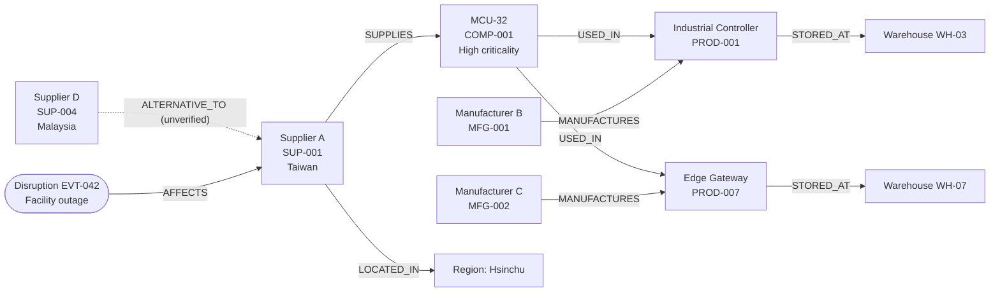
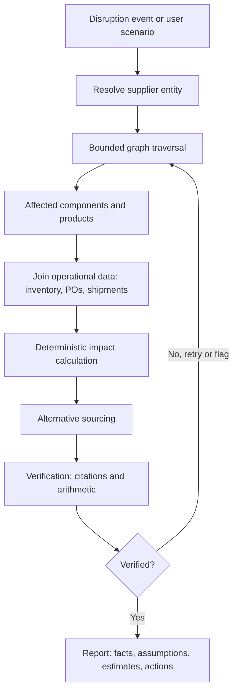

<div align="center">

# 🕸️ SupplyChainIQ

### Agentic GraphRAG for Supply Chain Risk, Dependency and Decision Intelligence

*Trace hidden dependencies. Investigate disruptions. Justify every decision with evidence.*


</div>

> **Project status: 🟠 Planned.** This document is the master specification. Nothing described here is implemented yet unless a checklist item in [Section 29](#29-development-roadmap-and-implementation-phases) is marked done. All datasets are synthetic or proposed, all scenario outputs are simulations, and **no benchmark results exist yet**. Result tables in this document are templates, not measurements.

> 🖼️ *Visual placeholders:* `docs/images/architecture-overview.png`, `docs/images/control-tower.png`, `docs/images/graph-explorer.png`, `docs/images/investigation-workspace.png`. Replace with real screenshots once the UI exists.

---

## 📑 Table of Contents

1. [Executive Summary](#1-executive-summary)
2. [Problem Statement and Industry Context](#2-problem-statement-and-industry-context)
3. [Product Vision, Goals and Scope](#3-product-vision-goals-and-scope)
4. [End-to-End Industry Scenario](#4-end-to-end-industry-scenario)
5. [Feature Catalogue](#5-feature-catalogue)
6. [System Architecture](#6-system-architecture)
7. [Technology Stack and Technical Decisions](#7-technology-stack-and-technical-decisions)
8. [Domain Model and Knowledge Graph Schema](#8-domain-model-and-knowledge-graph-schema)
9. [Relational Database Design](#9-relational-database-design)
10. [GraphRAG Architecture and Implementation](#10-graphrag-architecture-and-implementation)
11. [Hybrid Retrieval and Ranking](#11-hybrid-retrieval-and-ranking)
12. [Agentic RAG Architecture](#12-agentic-rag-architecture)
13. [Risk Intelligence and Analytical Engine](#13-risk-intelligence-and-analytical-engine)
14. [Alternative Supplier Intelligence](#14-alternative-supplier-intelligence)
15. [Document Intelligence and Data Ingestion](#15-document-intelligence-and-data-ingestion)
16. [API Architecture and Endpoint Catalogue](#16-api-architecture-and-endpoint-catalogue)
17. [Backend Application Architecture](#17-backend-application-architecture)
18. [Frontend and UX Architecture](#18-frontend-and-ux-architecture)
19. [Repository Structure](#19-repository-structure)
20. [Dataset Strategy and Data Sources](#20-dataset-strategy-and-data-sources)
21. [Evaluation and Benchmarking](#21-evaluation-and-benchmarking)
22. [Testing Strategy](#22-testing-strategy)
23. [Observability and Monitoring](#23-observability-and-monitoring)
24. [Security and Responsible AI](#24-security-and-responsible-ai)
25. [Synchronization, Reliability and Distributed Processing](#25-synchronization-reliability-and-distributed-processing)
26. [Deployment and Infrastructure](#26-deployment-and-infrastructure)
27. [Environment Variables and Configuration](#27-environment-variables-and-configuration)
28. [Engineering Principles](#28-engineering-principles)
29. [Development Roadmap and Implementation Phases](#29-development-roadmap-and-implementation-phases)
30. [AI Coding Agent Development Protocol](#30-ai-coding-agent-development-protocol)
31. [Acceptance Criteria and Definition of Done](#31-acceptance-criteria-and-definition-of-done)
32. [Limitations and Risks](#32-limitations-and-risks)
33. [Future Enhancements](#33-future-enhancements)
34. [Portfolio Presentation](#34-portfolio-presentation)
35. [Glossary and Naming Conventions](#35-glossary-and-naming-conventions)

---

## 1. Executive Summary

**SupplyChainIQ** is a decision-intelligence platform that models a supply chain as a knowledge graph, enriches it with evidence from structured and unstructured sources, and lets analysts and autonomous, tool-bounded agents investigate questions such as:

> *"If Supplier A is unavailable for 30 days, which components, products, manufacturers and warehouses are affected, what is our estimated exposure, and which alternative suppliers satisfy our constraints?"*

**What problem it solves.** Supply chain facts live in ERP exports, spreadsheets, contracts and supplier reports. Operational systems can say *a shipment is late*; they rarely say *which downstream products depend on this supplier through shared components, what the contract allows, and what the realistic alternatives are*.

**Who uses it.** Supply chain risk analysts, procurement managers, manufacturing planners, logistics coordinators and operations leadership.

**How it works (high level).**

1. Structured records (PostgreSQL) and documents (PDF, DOCX, CSV, …) are ingested asynchronously.
2. Entities and relationships are extracted, **resolved**, and written to Neo4j with **provenance** on every edge.
3. Document chunks are embedded into pgvector and indexed for lexical search.
4. A **query router** chooses a retrieval strategy (vector, BM25, graph traversal, community summaries, structured SQL) instead of running everything for every query.
5. A **LangGraph** multi-agent workflow plans investigations, calls bounded read-only tools, runs **deterministic** risk and impact calculations, verifies evidence, and produces a cited report.

**How it differs from dashboards and document chatbots.**

| Capability | BI dashboard | Document chatbot (vector RAG) | **SupplyChainIQ** |
|---|---|---|---|
| Aggregations over known fields | ✅ | ❌ | ✅ |
| Free-text questions | ❌ | ✅ | ✅ |
| Multi-hop dependency reasoning | ❌ | ❌ (weak) | ✅ graph traversal |
| Evidence provenance per fact | ❌ | partial | ✅ per edge and per claim |
| Deterministic, reproducible numbers | ✅ | ❌ | ✅ separate from LLM |
| Autonomous multi-step investigation | ❌ | ❌ | ✅ bounded agents |
| Fact vs. assumption vs. estimate labeling | ❌ | ❌ | ✅ enforced in reports |

**Core engineering capabilities:** hybrid GraphRAG, entity resolution, community-based global retrieval, LangGraph agents with verification, explainable risk scoring, deterministic scenario simulation, outbox-based cross-store synchronization, multi-tenant security, LLM observability, and a reproducible four-way benchmark.

---

## 2. Problem Statement and Industry Context

Each real-world problem below is mapped to the capability that addresses it.

| # | Challenge | Why it is hard | SupplyChainIQ capability |
|---|---|---|---|
| 1 | **Supplier concentration** | Reliance is hidden when spend is split across entities that share a parent or a sub-supplier | Entity resolution + concentration metrics (§13) |
| 2 | **Multi-tier dependencies** | Tier-2/3 relationships are not in the ERP | Graph traversal with bounded depth (§10) |
| 3 | **Component shortages** | A single component can be used by many products | `Component → Product` fan-out analysis |
| 4 | **Logistics disruptions** | Route and port events affect shipments indirectly | `Shipment → Route → Region` modeling |
| 5 | **Geographic concentration** | Many suppliers in one risk region | Region-level exposure + community detection |
| 6 | **Procurement dependency** | Single-source parts with no qualified alternative | Single-point-of-failure detection |
| 7 | **Shipment delays** | Delay is reported, impact is not | Delay-to-impact propagation in scenario engine |
| 8 | **Contractual constraints** | Minimum volumes, exclusivity, force majeure sit in PDFs | Contract extraction + document research agent |
| 9 | **Incomplete visibility** | Unknown sub-suppliers | Explicit `unknown/unverified` provenance states and gap reporting |
| 10 | **Fragmented information** | Many systems and formats | Unified ingestion into three synchronized stores |
| 11 | **Difficult impact tracing** | Needs joins across many tables and documents | Multi-hop retrieval + deterministic impact calculation |
| 12 | **No explainable decision support** | Black-box scores and chatbot answers | Evidence trails, path explanations, labeled assumptions |

### Why conventional vector RAG is insufficient

1. **Relationships are not similarity.** "Which products depend on Supplier A through shared components?" is a path query. Embeddings retrieve passages *about* Supplier A, not the transitive closure of its dependents.
2. **Completeness matters.** Missing one of twelve affected products is a materially wrong answer. Top-K similarity has no completeness guarantee; graph traversal over a validated graph does.
3. **Aggregation and arithmetic.** Exposure = quantity × price × duration × share. LLMs are unreliable at this; deterministic code is required.
4. **Provenance and conflict.** An ERP fact, an LLM-extracted contract clause and a human-verified edge have different authority. Chunks alone carry no such structure.
5. **Global questions.** "Which supplier cluster is most concentrated?" requires corpus-level structure (communities), not nearest-neighbor chunks.
6. **Multi-step work.** Investigations involve planning, tool use, verification and reporting, which a single prompt-response cycle does not provide.

Vector RAG is still valuable here (contract clauses, supplier reports, news). It is one retrieval strategy among several, not the architecture.

---

## 3. Product Vision, Goals and Scope

**Vision.** Every supply chain decision should be traceable to evidence, and every dependency, however indirect, should be discoverable in seconds.

**Mission.** Provide analysts with an investigation workspace that combines graph reasoning, document intelligence and deterministic analytics, while keeping humans in control of consequential decisions.

### Objectives

- Build a unified, provenance-aware knowledge graph of the supply chain.
- Answer multi-hop, relational and global questions with cited evidence.
- Compute explainable risk scores and scenario impacts deterministically.
- Run bounded, observable agentic investigations.
- Measure quality with a reproducible benchmark rather than anecdotes.

### Functional scope

Supplier/product/component modeling, document ingestion, GraphRAG Q&A, investigations, risk scoring, scenario simulation, alternative sourcing, reporting, graph visualization, RBAC and multi-tenancy.

### Non-functional scope

Tenant isolation, auditability, idempotent processing, observability, reproducible local setup, bounded latency and cost per investigation (targets set during Phase 11, not assumed).

### Personas and stakeholders

| Persona | Needs |
|---|---|
| **Risk Analyst** | Investigate disruptions, understand exposure, produce reports |
| **Procurement Manager** | Compare alternatives, review contract constraints |
| **Operations Planner** | See affected products, shipments and warehouses |
| **Executive Viewer** | Read summaries and risk overview |
| **Platform Admin** | Manage users, ingestion, audit logs |
| **Data Steward** | Verify extracted relationships, resolve entity conflicts |

Stakeholders: procurement, manufacturing, logistics, finance, compliance/security, IT/platform.

### Supported use cases

Disruption investigation; dependency tracing; hidden-concentration discovery; contract constraint lookup; alternative supplier evaluation; regional risk review; document-grounded Q&A.

### Out of scope

- Executing purchase orders or modifying ERP data.
- Real-time carrier tracking and live ERP integration (extension only).
- Validated demand forecasting or probabilistic risk prediction.
- Legal or financial advice. Outputs are decision support.
- Supplier negotiation automation.

### Constraints

Solo-developer feasibility; synthetic data as the primary dataset; LLM API cost budget; no confidential enterprise data.

### Assumptions

- A single organization's data is graph-isolated by `organization_id`.
- Synthetic data is internally consistent but not representative of any real company.
- Scenario parameters are user-provided assumptions.

### Risks and mitigations (summary; full list in [§32](#32-limitations-and-risks))

| Risk | Mitigation |
|---|---|
| LLM extraction errors pollute the graph | Confidence thresholds, human verification queue, provenance tiers |
| Scope creep | Phase gates, MVP definition |
| Cross-store drift | Outbox + reconciliation |
| Cost overruns | Per-investigation token budgets, caching |

### Release tiers

| Tier | Contents |
|---|---|
| **MVP** | Synthetic dataset, PostgreSQL + Neo4j, ingestion of CSV/PDF, hybrid retrieval, graph traversal, single-agent-plus-tools investigation, deterministic impact simulation, basic UI, auth |
| **Advanced** | Full LangGraph multi-agent system, community retrieval, reranking, verification agent, alternative sourcing, benchmark and observability, reports |
| **Production-oriented extension** | Hardening, CI/CD, AWS deployment, load tests, reconciliation jobs, external feeds (GDELT, Comtrade) |

---

## 4. End-to-End Industry Scenario

> ⚠️ **All entities and numbers below are synthetic illustrations.** "Supplier A" and its data are fictional. Scenario figures are **simulation outputs under stated assumptions**, not confirmed losses.

### 4.1 Setting

An electronics manufacturer (the tenant) builds industrial controllers and gateway devices. **Supplier A (SUP-001)**, a semiconductor producer in Taiwan, supplies microcontroller `COMP-001` (criticality: High).

### 4.2 Graph excerpt



### 4.3 Step-by-step flow

| # | Step | System behavior | Output type |
|---|---|---|---|
| 1 | **Receive disruption** | News item or analyst entry creates `Disruption EVT-042` (source: analyst entry, verified: false) | Fact (as reported) |
| 2 | **Identify supplier** | NER on disruption text yields "Supplier A / SA Semiconductor Co." | Extracted entity |
| 3 | **Resolve in graph** | Entity resolution maps both aliases to `SUP-001` (score and evidence stored) | Inferred link + confidence |
| 4 | **Investigate dependencies** | Bounded traversal `Supplier→Component→Product→Manufacturer→Warehouse`, max 4 hops | Graph fact (provenance-tiered) |
| 5 | **Affected components/products** | `COMP-001` → `PROD-001`, `PROD-007` (+ indirect via sub-assembly `COMP-014`) | Graph fact |
| 6 | **Downstream manufacturers/facilities** | `MFG-001`, `MFG-002`, `WH-03`, `WH-07` | Graph fact |
| 7 | **Retrieve documents** | Contract `CON-0112` (min-volume, force majeure clause), 3 open shipments, a supplier report | Document evidence with chunk citations |
| 8 | **Evaluate impact** | Deterministic calc using on-hand inventory, daily consumption, disruption duration | **Scenario estimate** |
| 9 | **Find alternatives** | Candidate suppliers filtered by component compatibility, region, qualification | Potential alternatives |
| 10 | **Compare alternatives** | Hard constraints, then weighted ranking | Ranked recommendations (not approvals) |
| 11 | **Verify** | Verification agent recomputes numbers, checks every claim has citations, flags conflicts | Verification report |
| 12 | **Report** | Structured report with sections labeled *Observed facts / Assumptions / Estimates / Recommendations* | Final deliverable |

### 4.4 Disruption impact workflow



### 4.5 Sample user query and output excerpt

**Query:** *"Investigate the consequences of a 30-day disruption at Supplier A. Assume 100% capacity loss starting 2026-12-01."*

```json
{
  "investigation_id": "inv_7c1a...",
  "status": "completed",
  "scenario": {
    "type": "SIMULATION",
    "supplier_id": "SUP-001",
    "duration_days": 30,
    "capacity_reduction_pct": 100,
    "start_date": "2026-12-01",
    "assumptions": [
      "No partial shipments after start date",
      "Inventory consumption follows trailing 90-day average"
    ]
  },
  "observed_facts": [
    {
      "claim": "SUP-001 supplies COMP-001 (MCU-32), used in PROD-001 and PROD-007.",
      "provenance": "erp_import",
      "evidence": [{"type": "graph_path", "path_id": "p_0012"}]
    },
    {
      "claim": "Contract CON-0112 contains a force-majeure clause.",
      "provenance": "llm_extraction",
      "verified": false,
      "evidence": [{"type": "chunk", "document_id": "DOC-104", "chunk_id": "ch_88", "page": 7}]
    }
  ],
  "estimates": [
    {
      "metric": "days_of_inventory_cover_COMP-001",
      "value": 12,
      "label": "SCENARIO_ESTIMATE",
      "method": "on_hand / avg_daily_consumption",
      "inputs": {"on_hand": 14400, "avg_daily_consumption": 1200}
    },
    {
      "metric": "production_exposure_units",
      "value": 21600,
      "label": "SCENARIO_ESTIMATE",
      "method": "(duration - cover_days) * daily_demand"
    }
  ],
  "alternatives": [
    {
      "supplier_id": "SUP-004",
      "status": "CANDIDATE_NOT_QUALIFIED",
      "passes_hard_constraints": true,
      "score": 0.71,
      "evidence": [{"type": "supplier_record", "id": "SUP-004"}]
    }
  ],
  "verification": {"citations_valid": true, "calculations_reproduced": true, "open_flags": ["CON-0112 clause unverified by human"]}
}
```

(Numbers above are illustrative.)

---

## 5. Feature Catalogue

| Category | Feature | Tier |
|---|---|---|
| Supplier intelligence | Supplier profiles (attributes, relationships, risk, documents) | MVP |
| | Supplier comparison | Advanced |
| Knowledge graph | Neighborhood exploration, path view, provenance filter | MVP |
| | Community view and summaries | Advanced |
| Document intelligence | Upload, parse, chunk, embed, OCR | MVP (OCR Advanced) |
| | Contract constraint extraction | Advanced |
| Question answering | Vector + BM25 hybrid Q&A with citations | MVP |
| | GraphRAG (local graph retrieval) | MVP |
| | Community/global retrieval | Advanced |
| | Query router and rewriting | Advanced |
| Dependency analysis | Multi-hop dependency investigation | MVP |
| | Single point of failure detection | Advanced |
| Risk | Supplier risk score (explainable) | MVP |
| | Geographic risk, dependency criticality | Advanced |
| Simulation | Deterministic disruption scenario | MVP |
| | Monte Carlo | Future |
| Sourcing | Alternative supplier filter and ranking | Advanced |
| Agents | Single supervisor with tools | MVP |
| | Full multi-agent workflow with verification | Advanced |
| | Autonomous monitoring agents | Future |
| Reporting | Cited investigation report, export (PDF/MD) | MVP (PDF Advanced) |
| Visualizatio