<div align="center">

# 🕸️ SupplyChainIQ

### Agentic GraphRAG for Supply Chain Risk, Dependency and Decision Intelligence

**Trace hidden dependencies · Investigate disruptions · Justify every decision with evidence**


</div>

> [!IMPORTANT]
> **Project status: 🟠 Planned. This document is the master specification, version 0.2.**
> Nothing described here is implemented unless a roadmap item in [Section 11](#11-roadmap) is checked. All datasets are synthetic or proposed, all scenario outputs are simulations, and **no benchmark results exist yet**. Every result table in this document is a template, not a measurement. Every number in an example is illustrative.

> 🖼️ *Visual placeholders (replace with real screenshots once the UI exists):* `docs/images/architecture-overview.png` · `docs/images/control-tower.png` · `docs/images/graph-explorer.png` · `docs/images/investigation-workspace.png`

---

## 🧭 At a Glance

**SupplyChainIQ is a decision-intelligence platform that turns a supply chain into an evidence-backed knowledge graph, then lets analysts and tightly bounded AI agents investigate questions that dashboards and document chatbots cannot answer.**

> *"If Supplier A is unavailable for 30 days, which components, products, manufacturers and warehouses are affected, what is our estimated exposure, which contract clauses constrain us, and which alternative suppliers satisfy our constraints?"*

| | |
|---|---|
| **The core problem** | Supply-chain facts are scattered across ERP exports, contracts, shipment feeds and spreadsheets. Systems can say *"a shipment is late"*; they cannot say *"which products silently depend on this supplier, what the contract allows, and what the realistic alternatives are."* |
| **The core idea** | Model the chain as a **provenance-aware graph**; retrieve with a **router** instead of one-size-fits-all RAG; compute every number in **deterministic code**; let **read-only, budgeted agents** do the legwork; **verify** before reporting. |
| **The core promise** | Every claim in an answer is traceable to a graph path, a document passage or a recomputable calculation, and is labelled **fact · assumption · estimate · recommendation**. |
| **What it is not** | Not a forecasting model, not an ERP replacement, not an autonomous procurement bot. Outputs are decision support. |

### Technology map

| Layer | Technology | One-line role |
|---|---|---|
| Experience | React · TypeScript · Tailwind · Cytoscape.js · React Flow | Control tower, graph explorer, investigation workspace |
| API | FastAPI · Pydantic v2 · SSE | Typed async API, streaming progress |
| Intelligence | LangGraph · custom GraphRAG engine · deterministic domain services | Planning, retrieval, risk and impact maths |
| Knowledge | Neo4j (+ GDS) | Multi-hop traversal, path explanations, communities |
| Operational truth | PostgreSQL · SQLAlchemy 2 · Alembic | Transactions, tenancy, outbox, job state |
| Semantic | pgvector (HNSW) · tsvector · cross-encoder reranker | Dense and lexical retrieval, precision at top-K |
| Async | Celery · Redis · transactional outbox | Ingestion, sync, community builds |
| Storage | S3 / MinIO | Immutable raw documents |
| Quality | pytest · Testcontainers · Hypothesis · RAGAS · Langfuse · Prometheus · Grafana | Tests, evaluation, tracing, metrics |
| Delivery | Docker Compose · GitHub Actions · AWS | Reproducible local and single-host deployment |

### How to read this document

| If you are… | Read |
|---|---|
| **A recruiter or reviewer (5 min)** | [§1](#1-executive-overview) → [§2](#2-motivation-and-problem-statement) → [§3.4 scenario](#34-end-to-end-scenario) → [§6.1 biggest cons](#61-the-ten-biggest-cons-in-one-table) |
| **An engineer joining the project** | [§4](#4-system-architecture) → [§5](#5-component-deep-dives) → [§7](#7-knowledge-graph-and-data-model) |
| **An AI coding agent** | [§12](#12-ai-coding-agent-protocol) first, then the component you are changing in [§5](#5-component-deep-dives) |
| **Evaluating rigor** | [§6](#6-technology-stack-trade-offs) → [§9](#9-evaluation-and-testing) → [§13](#13-acceptance-limitations-and-future-work) |

---

## 📑 Table of Contents

1. [Executive Overview](#1-executive-overview)
2. [Motivation and Problem Statement](#2-motivation-and-problem-statement)
3. [Solution Overview and Design Thesis](#3-solution-overview-and-design-thesis)
4. [System Architecture](#4-system-architecture)
5. [Component Deep Dives](#5-component-deep-dives)
   - [5.1 Ingestion and Document Intelligence](#51-ingestion-and-document-intelligence)
   - [5.2 Knowledge Graph Construction](#52-knowledge-graph-construction)
   - [5.3 Storage Layer and Synchronization](#53-storage-layer-and-synchronization)
   - [5.4 GraphRAG Retrieval Engine](#54-graphrag-retrieval-engine)
   - [5.5 Agentic Orchestration](#55-agentic-orchestration)
   - [5.6 Risk and Scenario Engine](#56-risk-and-scenario-engine)
   - [5.7 Alternative Supplier Intelligence](#57-alternative-supplier-intelligence)
   - [5.8 API and Backend Application](#58-api-and-backend-application)
   - [5.9 Frontend and Visualization](#59-frontend-and-visualization)
   - [5.10 Observability and Evaluation Loop](#510-observability-and-evaluation-loop)
   - [5.11 Security and Tenancy](#511-security-and-tenancy)
   - [5.12 Deployment and CI/CD](#512-deployment-and-cicd)
6. [Technology Stack Trade-offs](#6-technology-stack-trade-offs)
7. [Knowledge Graph and Data Model](#7-knowledge-graph-and-data-model)
8. [API Reference](#8-api-reference)
9. [Evaluation and Testing](#9-evaluation-and-testing)
10. [Repository, Configuration and Local Development](#10-repository-configuration-and-local-development)
11. [Roadmap](#11-roadmap)
12. [AI Coding Agent Protocol](#12-ai-coding-agent-protocol)
13. [Acceptance, Limitations and Future Work](#13-acceptance-limitations-and-future-work)
14. [Portfolio Presentation and Glossary](#14-portfolio-presentation-and-glossary)

---

## 1. Executive Overview

**SupplyChainIQ** models a supply chain as a knowledge graph, enriches it with evidence from structured and unstructured sources, and lets analysts and tool-bounded agents investigate disruption questions end to end.

### 1.1 The system in one picture

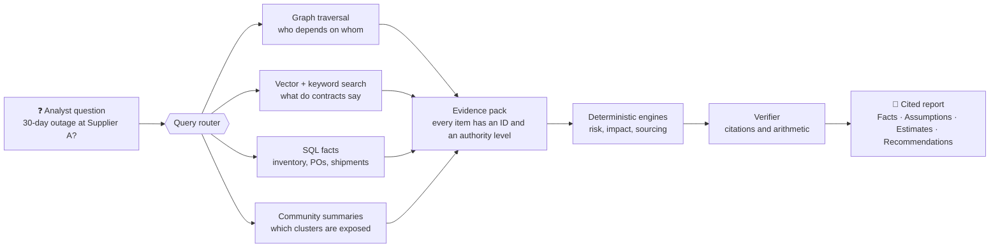

### 1.2 How it differs from what exists

| Capability | BI dashboard | Document chatbot (vector RAG) | **SupplyChainIQ** |
|---|---|---|---|
| Aggregations over known fields | ✅ | ❌ | ✅ |
| Free-text questions | ❌ | ✅ | ✅ |
| Multi-hop dependency reasoning | ❌ | ⚠️ weak | ✅ graph traversal |
| Completeness over relationships | ✅ for known joins | ❌ top-K only | ✅ bounded traversal over a validated graph |
| Evidence provenance per fact | ❌ | ⚠️ partial | ✅ per edge and per claim |
| Deterministic, reproducible numbers | ✅ | ❌ | ✅ separated from the LLM |
| Autonomous multi-step investigation | ❌ | ❌ | ✅ bounded agents |
| Fact / assumption / estimate labelling | ❌ | ❌ | ✅ enforced by the verifier |

### 1.3 Core engineering capabilities

Hybrid GraphRAG with a query router · entity resolution with reversible merges · community-based global retrieval · LangGraph agents with a verification stage · explainable, versioned risk scoring · deterministic scenario simulation · transactional-outbox synchronization across three stores · multi-tenant isolation at every retrieval layer · LLM observability · a reproducible four-system benchmark.

---

## 2. Motivation and Problem Statement

### 2.1 Motivation

A fab outage hits the news on Monday morning. The question from leadership is simple: *"Are we exposed?"*

The data needed to answer it exists, but it lives in five places:

- the **bill of materials** is in the ERP,
- the **contract** with the supplier, including its force-majeure and minimum-volume clauses, is a PDF on a shared drive,
- **open shipments** are in a logistics export,
- the list of **possible alternates** is in somebody's spreadsheet or somebody's head,
- the **news** is in browser tabs.

An analyst joins these by hand. Two things go wrong in practice. It is **slow**, because the joins take hours to days. And it is **silently incomplete**, because a missed shared sub-component or an unrecorded sub-supplier produces an answer that looks fine and is not. There is no audit trail of what was checked, what was assumed, and what was never visible.

SupplyChainIQ exists to make the second failure mode, the confident-but-incomplete answer, structurally difficult.

### 2.2 The problem in one picture

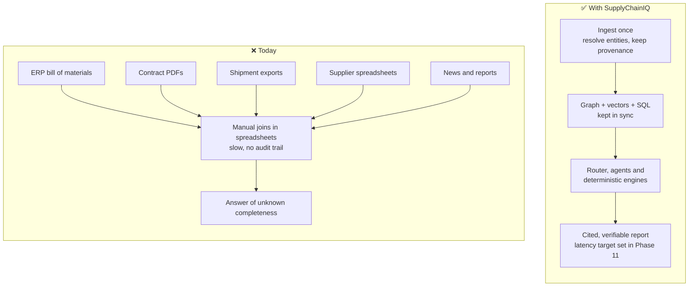

### 2.3 Formal problem statement

> **Given** heterogeneous, partially trusted, partially incomplete data about suppliers, components, products, facilities, shipments and contracts,
> **produce** answers to relational, quantitative and document-grounded questions
> **such that** each answer is *complete* over what is known, *attributable* to its sources, *reproducible* in its numbers, and *honest* about what is unknown or assumed, while any automation involved stays *bounded* and *read-only*.

Those four properties are what make the problem hard, and each one drives a specific design decision:

| Property | Why it is hard | How SupplyChainIQ guarantees it |
|---|---|---|
| **Completeness** | Missing 1 of 12 affected products is a materially wrong answer; top-K similarity gives no completeness guarantee | Bounded graph traversal over a validated graph, with explicit truncation flags and gap findings |
| **Attribution** | An ERP row, an LLM-extracted clause and a steward-verified edge have different authority | Provenance map on every edge; authority ladder; evidence IDs on every claim |
| **Reproducibility** | LLMs are unreliable at arithmetic and non-deterministic at generation | All numbers from pure domain services; recomputed by the verifier; LLM never does maths |
| **Bounded autonomy** | Agents with raw database access are a security and correctness liability | Typed tools over allowlisted Cypher/SQL templates, tenant injected server-side, read-only DB role, budgets |

### 2.4 Why existing approaches fall short

| Approach | What it does well | Where it fails for this problem |
|---|---|---|
| **ERP / BI dashboards** | Fast aggregates over known schemas | Cannot read contracts; cannot traverse unknown-depth relationships; no free-text questions |
| **Vector RAG chatbot** | Paraphrase-tolerant lookup in documents | Relationships are not similarity; no completeness; no arithmetic; no provenance hierarchy |
| **Graph database alone** | Excellent traversal | No text understanding, no operational numbers, no natural-language interface, and graph quality is only as good as ingestion |
| **LLM agent with raw SQL or Cypher access** | Flexible | Unsafe (injection, cross-tenant leaks), non-reproducible, hard to evaluate |
| **SupplyChainIQ** | Combines graph, text, SQL and deterministic maths behind a router, with verified agents | Costs: three data stores, eventual consistency, LLM extraction risk (see [§6](#6-technology-stack-trade-offs)) |

### 2.5 Twelve real-world challenges mapped to capabilities

| # | Challenge | Why it is hard | SupplyChainIQ capability | See |
|---|---|---|---|---|
| 1 | **Supplier concentration** | Reliance hides when spend is split across entities sharing a parent or sub-supplier | Entity resolution + concentration metrics | [5.2](#52-knowledge-graph-construction), [5.6](#56-risk-and-scenario-engine) |
| 2 | **Multi-tier dependencies** | Tier-2/3 links are not in the ERP | Bounded multi-hop traversal | [5.4](#54-graphrag-retrieval-engine) |
| 3 | **Component shortages** | One component feeds many products | `Component → Product` fan-out analysis | [5.6](#56-risk-and-scenario-engine) |
| 4 | **Logistics disruptions** | Route and port events act indirectly | `Shipment → Route → Region` modelling | [7](#7-knowledge-graph-and-data-model) |
| 5 | **Geographic concentration** | Many suppliers in one risk region | Region exposure + community detection | [5.4](#54-graphrag-retrieval-engine) |
| 6 | **Procurement dependency** | Single-source parts without a qualified alternative | Single-point-of-failure detection | [5.6](#56-risk-and-scenario-engine) |
| 7 | **Shipment delays** | Delay is reported; impact is not | Delay-to-impact propagation in scenario engine | [5.6](#56-risk-and-scenario-engine) |
| 8 | **Contractual constraints** | Minimum volumes, exclusivity, force majeure sit in PDFs | Contract extraction + document research agent | [5.1](#51-ingestion-and-document-intelligence), [5.5](#55-agentic-orchestration) |
| 9 | **Incomplete visibility** | Unknown sub-suppliers | Explicit `unverified` states and gap findings | [5.2](#52-knowledge-graph-construction) |
| 10 | **Fragmented information** | Many systems, many formats | One ingestion pipeline into three synchronized stores | [5.3](#53-storage-layer-and-synchronization) |
| 11 | **Difficult impact tracing** | Needs joins across tables and documents | Multi-hop retrieval + deterministic impact calculation | [5.4](#54-graphrag-retrieval-engine), [5.6](#56-risk-and-scenario-engine) |
| 12 | **No explainable decision support** | Black-box scores and chatbot answers | Evidence trails, path explanations, labelled assumptions | [5.5](#55-agentic-orchestration), [5.9](#59-frontend-and-visualization) |

### 2.6 Why conventional vector RAG is insufficient

1. **Relationships are not similarity.** "Which products depend on Supplier A through shared components?" is a path query; embeddings retrieve passages *about* Supplier A, not the transitive closure of its dependents.
2. **Completeness matters.** Top-K has no completeness guarantee; traversal over a validated graph does.
3. **Aggregation and arithmetic.** Exposure = quantity × price × duration × share. This needs code, not an LLM.
4. **Provenance and conflict.** Chunks carry no notion of authority or contradiction.
5. **Global questions.** "Which supplier cluster is most concentrated?" needs corpus-level structure (communities), not nearest neighbours.
6. **Multi-step work.** Investigations involve planning, tool use, verification and reporting.

Vector RAG remains valuable here (contract clauses, supplier reports, news). It is **one retrieval strategy among several, not the architecture**.

---

## 3. Solution Overview and Design Thesis

### 3.1 Vision, mission, objectives

- **Vision.** Every supply chain decision is traceable to evidence, and every dependency, however indirect, is discoverable in seconds.
- **Mission.** Give analysts an investigation workspace that combines graph reasoning, document intelligence and deterministic analytics, with humans in control of consequential decisions.
- **Objectives.** (1) A unified provenance-aware knowledge graph. (2) Cited answers to multi-hop, relational and global questions. (3) Deterministic, explainable risk and scenario numbers. (4) Bounded, observable agentic investigations. (5) Quality measured by a reproducible benchmark, not anecdotes.

### 3.2 Design thesis: who does what

The most important design decision is the **division of labour** between language models, deterministic code and humans.

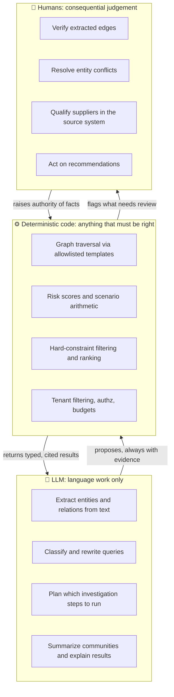

### 3.3 Design principles

| # | Principle | Concrete rule in this project |
|---|---|---|
| 1 | **Evidence before eloquence** | No finding without evidence or an explicit assumption label |
| 2 | **LLMs plan and explain; code computes** | Numbers never originate from an LLM |
| 3 | **Authority is explicit** | `human_verified` > `erp_import` > `document_extraction` > `llm_inferred`; surfaced in every answer |
| 4 | **Route, don't blast** | The router picks retrieval strategies; unclear routing falls back to *hybrid with small K*, never *everything* |
| 5 | **Bounded autonomy** | Agents get typed read-only tools, hop and row caps, timeouts, token and step budgets |
| 6 | **Projections are rebuildable** | PostgreSQL is truth; Neo4j and vectors can be rebuilt from it |
| 7 | **Idempotent by default** | Every ingestion, graph and index write is replay-safe |
| 8 | **Measure, don't assert** | Every retrieval or agent change is evaluated on the benchmark |
| 9 | **Appropriate complexity** | Modular monolith, Compose, no Kafka or Kubernetes until a measured need |

### 3.4 End-to-end scenario

> ⚠️ **Everything below is synthetic.** "Supplier A" is fictional. Figures are **simulation outputs under stated assumptions**, never confirmed losses.

An electronics manufacturer builds industrial controllers and gateways. **Supplier A (`SUP-001`)**, a Taiwan semiconductor producer, supplies microcontroller `COMP-001` (criticality: High).

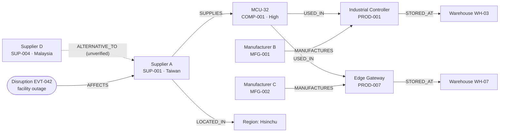

| # | Step | System behaviour | Output type |
|---|---|---|---|
| 1 | Receive disruption | Analyst entry or news item creates `EVT-042` (`verified: false`) | Fact (as reported) |
| 2 | Identify supplier | NER on the text yields "Supplier A / SA Semiconductor Co." | Extracted entity |
| 3 | Resolve in graph | Both aliases map to `SUP-001`, with score and evidence stored | Inferred link + confidence |
| 4 | Investigate dependencies | Bounded traversal Supplier→Component→Product→Manufacturer→Warehouse, max 4 hops | Graph fact (authority-tiered) |
| 5 | Affected components and products | `COMP-001` → `PROD-001`, `PROD-007` (+ indirect via sub-assembly) | Graph fact |
| 6 | Downstream sites | `MFG-001`, `MFG-002`, `WH-03`, `WH-07` | Graph fact |
| 7 | Retrieve documents | Contract `CON-0112` (min-volume, force-majeure), 3 open shipments, a supplier report | Document evidence with chunk citations |
| 8 | Evaluate impact | Deterministic calculation from on-hand stock, consumption and duration | **Scenario estimate** |
| 9 | Find and compare alternatives | Hard-constraint filter, then weighted ranking | Ranked *candidates* (never approvals) |
| 10 | Verify | Recompute numbers, validate citations, flag conflicts | Verification report |
| 11 | Report | Sections: *Observed facts / Assumptions / Estimates / Recommendations* | Final deliverable |

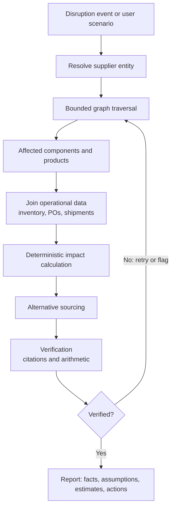

**Sample investigation output** *(illustrative)*

```json
{
  "investigation_id": "inv_7c1a",
  "status": "completed_with_caveats",
  "scenario": {
    "type": "SIMULATION",
    "supplier_id": "SUP-001",
    "duration_days": 30,
    "capacity_reduction_pct": 100,
    "start_date": "2026-12-01",
    "assumptions": ["No partial shipments after start date",
                    "Inventory consumption follows trailing 90-day average"]
  },
  "observed_facts": [
    {"claim": "SUP-001 supplies COMP-001 (MCU-32), used in PROD-001 and PROD-007.",
     "authority": "erp_import",
     "evidence": [{"type": "graph_path", "path_id": "p_0012"}]},
    {"claim": "Contract CON-0112 contains a force-majeure clause.",
     "authority": "document_extraction", "verified": false,
     "evidence": [{"type": "chunk", "document_id": "DOC-104", "chunk_id": "ch_88", "page": 7}]}
  ],
  "estimates": [
    {"metric": "days_of_inventory_cover_COMP-001", "value": 12, "label": "SCENARIO_ESTIMATE",
     "method": "on_hand / avg_daily_consumption", "inputs": {"on_hand": 14400, "avg_daily_consumption": 1200}},
    {"metric": "production_exposure_units", "value": 21600, "label": "SCENARIO_ESTIMATE",
     "method": "(duration - cover_days) * daily_demand"}
  ],
  "alternatives": [
    {"supplier_id": "SUP-004", "status": "CANDIDATE_NOT_QUALIFIED",
     "passes_hard_constraints": true, "score": 0.71}
  ],
  "verification": {"citations_valid": true, "calculations_reproduced": true,
                   "open_flags": ["CON-0112 clause not yet human-verified"]}
}
```

### 3.5 Personas, scope and release tiers

| Persona | Needs |
|---|---|
| **Risk analyst** | Investigate disruptions, understand exposure, produce reports |
| **Procurement manager** | Compare alternatives, review contract constraints |
| **Operations planner** | See affected products, shipments, warehouses |
| **Executive viewer** | Read summaries and risk overview |
| **Platform admin** | Manage users, ingestion, audit logs |
| **Data steward** | Verify extracted relationships, resolve entity conflicts |

**In scope:** supplier/product/component modelling, document ingestion, GraphRAG Q&A, investigations, risk scoring, scenario simulation, alternative sourcing, reporting, graph visualization, RBAC and multi-tenancy.

**Out of scope:** executing purchase orders or writing to the ERP · live carrier tracking and live ERP integration (extensions only) · validated demand forecasting or probabilistic risk prediction · legal or financial advice · negotiation automation.

| Tier | Contents |
|---|---|
| **MVP** | Synthetic dataset, PostgreSQL + Neo4j, CSV/PDF ingestion, hybrid retrieval, graph traversal, single-supervisor-with-tools investigation, deterministic impact simulation, basic UI, auth |
| **Advanced** | Full LangGraph multi-agent system, community retrieval, reranking, verification agent, alternative sourcing, benchmark, observability, reports |
| **Production-oriented** | Hardening, CI/CD, AWS deployment, load tests, reconciliation jobs, external feeds (GDELT, Comtrade) |

---

## 4. System Architecture

### 4.1 System context

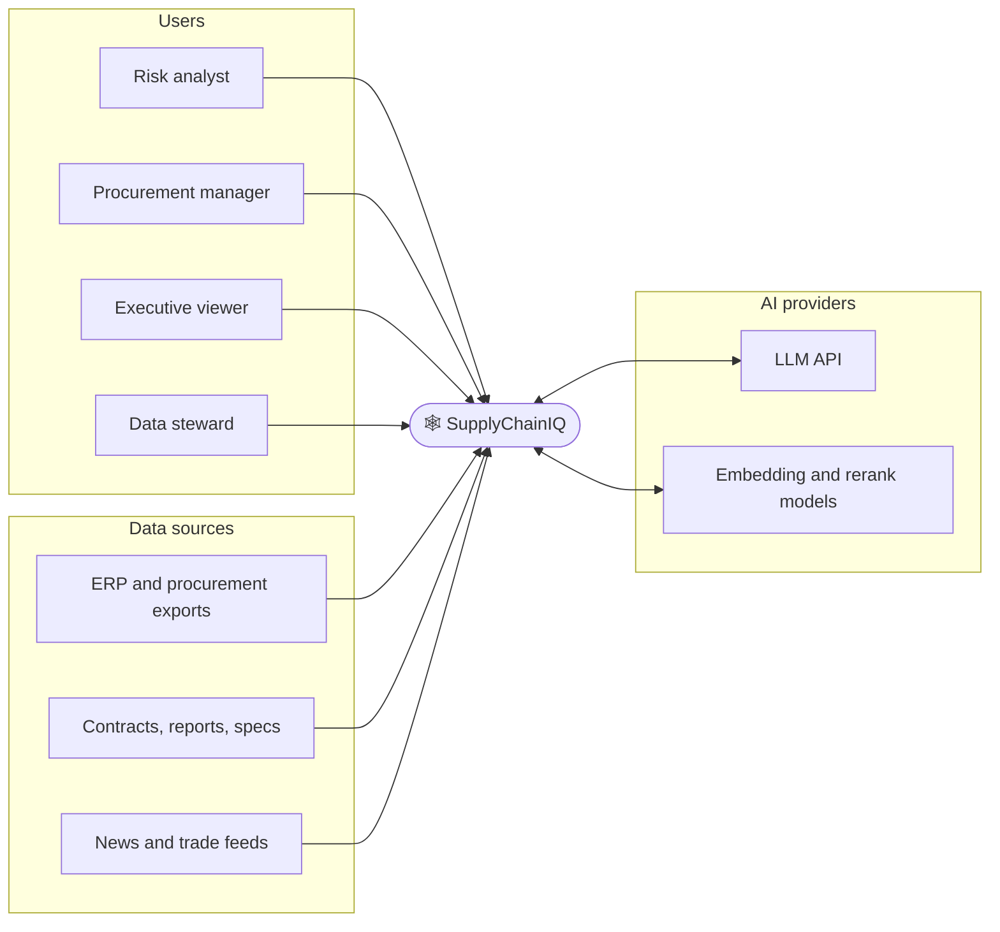

### 4.2 Container architecture

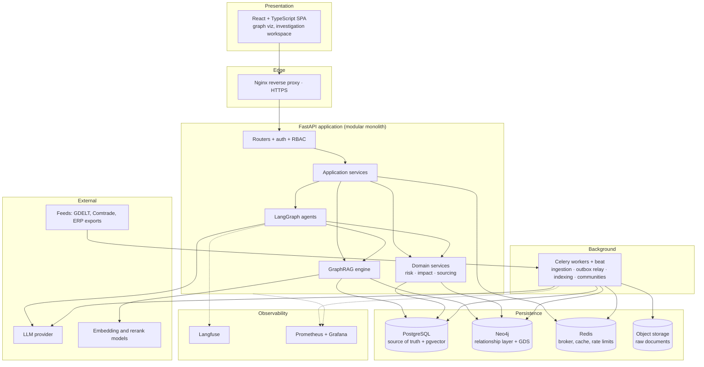

### 4.3 Four planes of the system

A useful mental model: the platform is four planes stacked on one another. Each plane has one job and only talks to its neighbour.

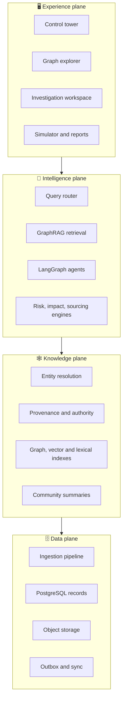

| Plane | Single responsibility | Primary components |
|---|---|---|
| **Data** | Get raw facts in safely and keep stores consistent | [5.1](#51-ingestion-and-document-intelligence), [5.3](#53-storage-layer-and-synchronization) |
| **Knowledge** | Turn facts into a trustworthy, queryable, provenance-aware model | [5.2](#52-knowledge-graph-construction) |
| **Intelligence** | Answer, compute, investigate and verify | [5.4](#54-graphrag-retrieval-engine) to [5.7](#57-alternative-supplier-intelligence) |
| **Experience** | Make evidence inspectable and decisions fast | [5.8](#58-api-and-backend-application), [5.9](#59-frontend-and-visualization) |

Cross-cutting concerns: [observability and evaluation](#510-observability-and-evaluation-loop), [security and tenancy](#511-security-and-tenancy), [deployment](#512-deployment-and-cicd).

### 4.4 Why three data stores, and what each owns

```mermaid
flowchart LR
    subgraph PGB["🐘 PostgreSQL: authoritative records"]
        P1["Users, orgs, roles"]
        P2["Suppliers, components, products, BOM"]
        P3["Inventory, POs, shipments, contracts"]
        P4["Jobs, outbox, audit log"]
        P5["Chunks + vectors + tsvector"]
    end
    subgraph NEO["🕸️ Neo4j: relationship reasoning"]
        N1["Nodes and typed edges"]
        N2["Edge provenance"]
        N3["GDS: communities, centrality"]
    end
    subgraph OBJ["📦 Object storage"]
        O1["Immutable raw files"]
    end
    PGB -- "outbox events (one-way)" --> NEO
    OBJ -- "parse and extract" --> PGB
```

| Store | Owns | Answers | Never used for |
|---|---|---|---|
| **PostgreSQL** | Transactions, tenancy, authoritative records, job state, outbox, chunks and vectors | "What is on hand?", "What does clause 7 say?", exact aggregates | Deep multi-hop traversal |
| **Neo4j** | A *derived projection* of relationships and their provenance | "Who depends on whom?", paths, communities, centrality | Being the source of truth for ERP facts |
| **Redis** | Ephemeral: Celery broker, cache, rate-limit counters | Nothing authoritative | Any state that cannot be lost |
| **Object storage** | Immutable raw artifacts | Re-parsing, audit | Querying |

**Conflict rule:** if PostgreSQL and Neo4j disagree about an ERP-derived fact, **PostgreSQL wins and Neo4j is repaired**. A full rebuild script (`rebuild_graph.py`) is a required deliverable, which is what makes Neo4j a *projection* rather than a second source of truth.

### 4.5 Query lifecycle

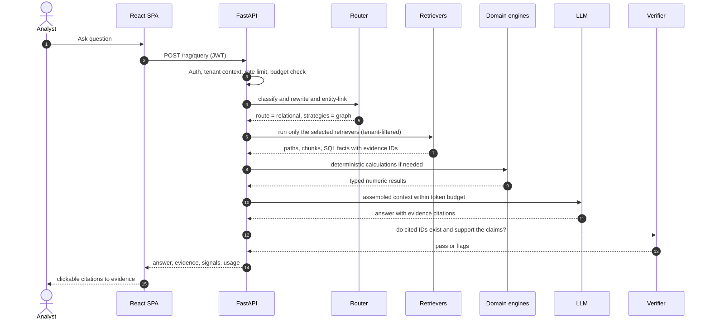

### 4.6 Consistency model

| Store | Consistency | Consequence |
|---|---|---|
| PostgreSQL | Strong (ACID) | Source of truth |
| Neo4j, pgvector indexes | **Eventually consistent** with PostgreSQL via the outbox | Investigations record the **graph watermark** (last processed event ID) they ran against; the UI shows a *"graph may lag source by N events"* notice above a threshold |
| Redis | Ephemeral | Loss triggers re-enqueue from the outbox, never data loss |

---
## 5. Component Deep Dives

Every component below follows the same template so it can be reviewed in isolation:

> **Why it exists** (the problem it solves) → **Workflow** (diagram) → **Tech stack for this component** (what, why, main con) → **Key decisions and failure modes**

Library names marked *(candidate)* are options to **verify against current docs and compatibility** during Phase 0, not commitments.

---

### 5.1 Ingestion and Document Intelligence

**Why it exists.** Real inputs are messy, duplicated, sometimes scanned, occasionally hostile, and arrive in many formats. Without a disciplined pipeline, bad parsing silently corrupts everything downstream: the graph, the vectors and the answers. This component converts raw files and feeds into validated, versioned, idempotent artifacts.

**Workflow**

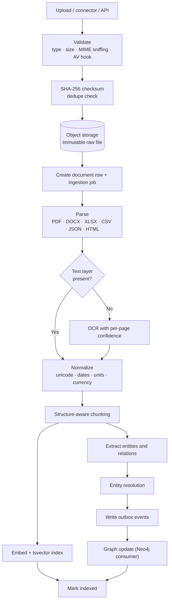

**Job state machine**

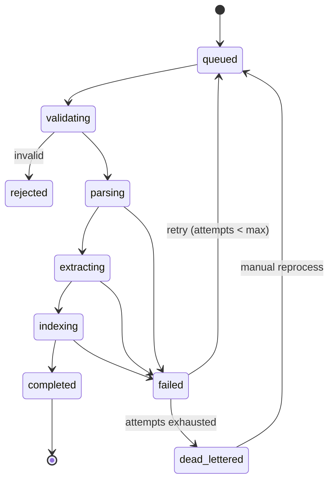

**Chunking strategy**

| Concern | Decision | Reason |
|---|---|---|
| Boundaries | Split on headings and clause numbers, not fixed character windows | Contract clauses are the semantic unit; fixed windows cut clauses in half |
| Size | Target 300–800 tokens with small overlap, **tuned on the benchmark** | Defaults are guesses until measured |
| Tables | Kept whole | Row-split tables lose column meaning |
| Metadata per chunk | `page`, `section`, `char_span`, document type, supplier IDs mentioned, reliability tier | Enables DB-level filtering and precise citations |

**Tech stack for this component**

| Technology | Role | Why this | Main con |
|---|---|---|---|
| **Celery + Redis** | Async job execution, retries, scheduling | Simple under Compose, supports retries, Beat and priority queues | At-least-once delivery means tasks can run twice, so every task must be idempotent |
| **S3 / MinIO** | Immutable raw artifact store | Parsed text is reproducible from raw files; cheap versioned storage | Another service to run locally; MinIO licensing and edition terms have changed over time, so verify |
| **PDF/DOCX parsers** *(candidate: PyMuPDF, pdfplumber, python-docx)* | Text, layout and table extraction | Text-layer-first is fast and accurate for born-digital files | Layout fidelity varies; multi-column and table-heavy PDFs need validation |
| **OCR** *(candidate: Tesseract or a cloud OCR)* | Scanned pages only | Avoids OCR cost and noise on files that have text | OCR errors propagate into extraction; confidence must be stored and respected |
| **Pydantic** | Data contracts per source (`supplier_csv_v1`, etc.) | Row-level validation with reject reports | Schema versions must be maintained as sources change |
| **SQLAlchemy** | `documents`, `ingestion_jobs` persistence | Typed, transactional | See [§6](#6-technology-stack-trade-offs) |

**Key decisions and failure modes**

| Decision / risk | Treatment |
|---|---|
| **Idempotency key** | `(organization, checksum, pipeline_version)`; chunk IDs are deterministic hashes of `(document_id, version, span)`, so reprocessing is safe |
| **Partial failure** | A bad page or row does not fail the document unless failures exceed a threshold; per-page errors recorded in `ingestion_jobs.error` |
| **Versioning** | A new upload of the same logical file creates `version+1`; older edges get `valid_to`, never deletion |
| **Hostile files** | Parsing runs in a sandboxed worker with no network; hidden text and metadata stripped; archive-bomb limits; random storage keys |
| **Near-duplicates** | Exact (checksum) and near-duplicate (MinHash/embedding) detection; duplicates link to the canonical document |
| **Reprocessing** | New `pipeline_version` writes new derived artifacts, then switches atomically |

---

### 5.2 Knowledge Graph Construction

**Why it exists.** The graph is only as trustworthy as its construction. LLM extraction is powerful but can hallucinate relations; supplier names arrive as "SA Semiconductor Co." and "Supplier A Ltd"; ERP facts and model guesses must never carry equal weight. This component builds the graph **defensively**, with evidence, thresholds and reversibility.

**Workflow**

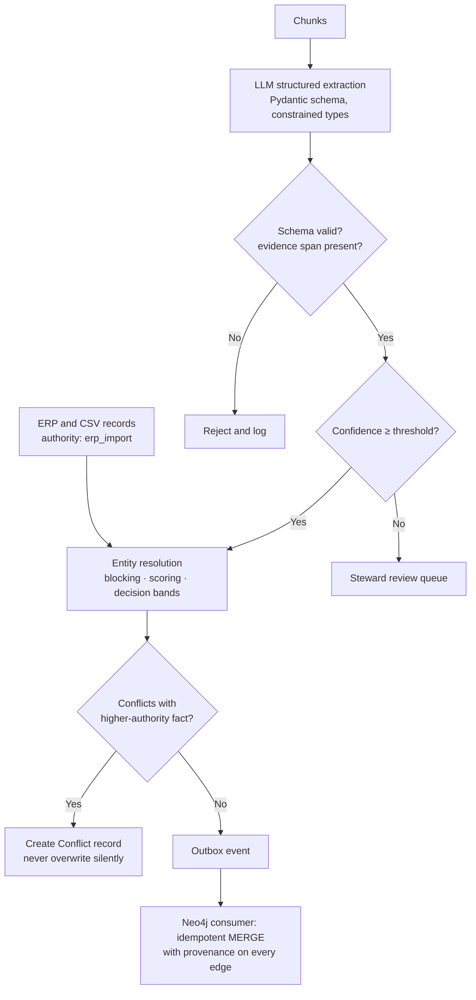

**The extraction contract.** Extraction output is constrained by a typed schema; an extracted relation without an evidence span is rejected before it can reach the graph.

```python
class ExtractedRelation(BaseModel):
    head: EntityMention
    relation: Literal["SUPPLIES", "USED_IN", "MANUFACTURES", "HAS_CONTRACT",
                      "COVERS", "ALTERNATIVE_TO", "LOCATED_IN"]   # schema allowlist
    tail: EntityMention
    evidence_span: Span          # required: document_id, chunk_id, char offsets
    confidence: float = Field(ge=0, le=1)
```

**Entity resolution decision bands**

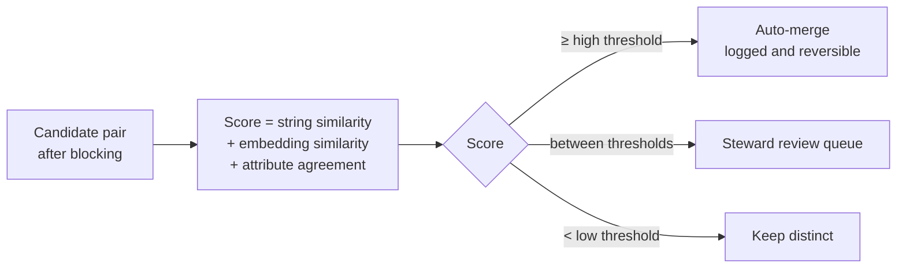

| ER step | Detail |
|---|---|
| **Blocking** | Normalized name tokens, country, DUNS-like identifiers when present, to avoid O(n²) comparisons |
| **Scoring** | Jaro-Winkler or token-set ratio + embedding similarity + attribute agreement (country, address) |
| **Merging** | Never destructive: `alias` records and `merged_from` provenance allow undo |
| **Calibration** | Thresholds fitted on the labelled alias manifest ([§9](#9-evaluation-and-testing)), not guessed; **false-merge rate is weighted heavily** because a wrong merge corrupts dependency paths |

**The authority ladder**

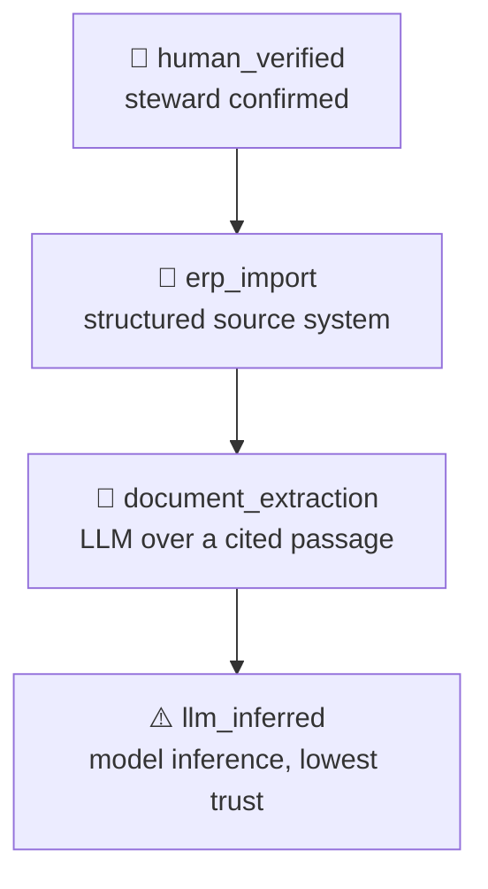

Conflicts never overwrite silently. Retrieval and agents **expose authority in every answer**, and `llm_inferred` edges can be excluded at query time with `min_authority`.

**Tech stack for this component**

| Technology | Role | Why this | Main con |
|---|---|---|---|
| **LLM structured output + Pydantic** | Typed entity and relation extraction | Schema-constrained output cuts free-form hallucination; validation is mechanical | Providers support only a subset of JSON Schema; extraction recall on long or noisy documents is unproven until benchmarked |
| **String-similarity libraries** *(candidate: RapidFuzz)* | ER candidate scoring | Fast, deterministic | Weak on transliteration and abbreviations alone, hence embedding and attribute signals |
| **Embeddings** | Semantic signal for ER and retrieval | Catch aliases lexical matching misses | Cost and dimension lock-in; see [§6](#6-technology-stack-trade-offs) |
| **Neo4j (MERGE + constraints)** | Idempotent graph writes | `MERGE` on a unique `uid` is replay-safe | Tenant-safe uniqueness depends on edition features, so `uid = "<org>:<business_id>"` is used |

**Failure modes:** hallucinated relation (mitigated by required evidence span, confidence gate, authority filter at query time, sampled edge audits) · false merge (conservative thresholds, reversible aliases, steward queue) · stale edge after document supersession (`valid_to` handling).

---

### 5.3 Storage Layer and Synchronization

**Why it exists.** Three stores are better at three different jobs, but three stores can drift apart. This component defines **who owns what** and **how change flows**, so inconsistency is detectable, bounded and repairable rather than silent.

**Workflow: transactional outbox**

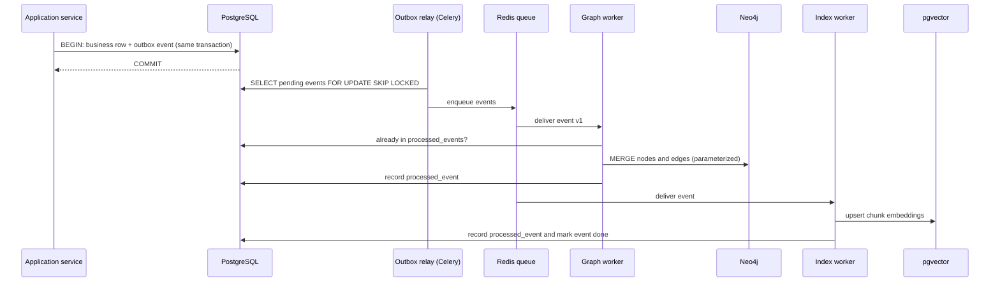

**Delivery guarantee.** At-least-once delivery plus idempotent consumers gives *effectively-once* results.

| Mechanism | Design |
|---|---|
| **Outbox** | `outbox_events` written in the same transaction as the change; relay marks `published`; consumers mark `processed` |
| **Event versioning** | `event_type` + `event_version`; consumers support N and N-1; unknown versions go to dead-letter |
| **Idempotency** | `processed_events(consumer, event_id)`; Cypher `MERGE`; vector upsert by deterministic chunk ID |
| **Ordering** | Per-aggregate routing key or sequence; consumers ignore stale `aggregate_version` |
| **Retries** | Exponential backoff with jitter; max attempts, then dead-letter with alert |
| **No dual writes** | Neo4j is written **only** from consumers, never in the request path |
| **Reconciliation** | Scheduled job compares counts, checksums and sampled records across PostgreSQL, Neo4j and pgvector per tenant; emits repair events; `rebuild_graph.py` is the full recovery path |

**Failure scenario (worked)**

> A user changes lead time for `SUP-001` from 21 to 35 days. The PostgreSQL transaction commits with outbox event `E-9081`. The graph worker applies the `MERGE`, then is **killed before recording `processed_events`**.
> **Effect:** the event is redelivered; the `MERGE` re-runs harmlessly; then it is recorded. Investigations that started inside the window see `graph_watermark < E-9081` and display a *"graph may lag source"* notice. If Neo4j is down for hours, the outbox-age alert fires; on recovery the relay drains the backlog in order and reconciliation confirms drift = 0.

**Tech stack for this component**

| Technology | Role | Why this | Main con |
|---|---|---|---|
| **PostgreSQL** | Source of truth, outbox, job state, vectors | ACID, JSONB, mature tooling, one transaction for business row and event | Outbox table has high churn: needs vacuum tuning and retention |
| **pgvector (HNSW)** | Dense retrieval inside PostgreSQL | One transaction for tenant and ACL filtering; no fourth datastore | Filtered ANN can lose recall under restrictive filters; HNSW build is memory-hungry; no native BM25 |
| **Neo4j** | Relationship projection | Cypher, native traversal, GDS | Extra operational surface; Community edition limits (see [§6](#6-technology-stack-trade-offs)) |
| **Redis** | Broker, cache, rate limits | Simple, fast | Ephemeral; licensing has changed across versions, so verify (Valkey is a compatible fork) |
| **SQLAlchemy 2 + Alembic** | ORM and migrations | Typed, async-capable, reviewed migrations | Autogenerate misses some objects (partial indexes, vector types) and needs manual review |

---

### 5.4 GraphRAG Retrieval Engine

**Why it exists.** Different questions need different evidence. Running every strategy for every query wastes tokens and adds noise; running only vector search misses relationships. The engine **routes**, retrieves with the cheapest sufficient strategies, fuses, reranks and assembles a **budgeted, labelled context**.

**Pipeline**

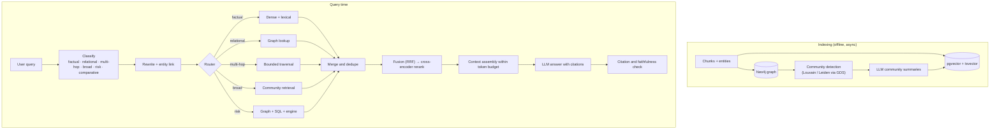

**Router decisions**

| Question pattern | Strategy | Why |
|---|---|---|
| "Who supplies `COMP-001`?" | Graph lookup (+ lexical for the ID) | Exact relation |
| "What does the contract say about late-delivery penalties?" | Dense + lexical over contracts | Text semantics |
| "Which products depend on Supplier A?" | Multi-hop traversal | Completeness over paths |
| "Which cluster is most exposed to Taiwan disruptions?" | Community retrieval + region filter | Global question |
| "What is our exposure if A fails for 30 days?" | Graph + SQL + deterministic engine (**no LLM maths**) | Numbers must be exact |
| "Compare Supplier D and E for `COMP-001`" | Graph paths + document retrieval + sourcing engine | Multiple evidence types |

> **Anti-pattern:** executing all strategies for all queries. When routing is unclear the fallback is **hybrid with small K**.

**Local graph retrieval: how traversal stays safe.** The LLM never writes Cypher. It selects a *named template*; the server fills parameters, injects the tenant, and enforces caps.

```cypher
// graph/queries/downstream_products.cypher  (validated, versioned, tenant-scoped)
MATCH (s:Supplier {uid: $supplier_uid, organization_id: $org_id})
MATCH path = (s)-[:SUPPLIES]->(c:Component)-[:USED_IN]->(p:Product)<-[:MANUFACTURES]-(m:Manufacturer)
WHERE all(n IN nodes(path) WHERE n.organization_id = $org_id)
  AND all(r IN relationships(path) WHERE r.provenance_authority IN $allowed_authorities)
RETURN s.name AS supplier, c.name AS component, p.name AS product, m.name AS manufacturer,
       [r IN relationships(path) | type(r)] AS rel_types
LIMIT $max_results
```

| Guardrail | Default (tune) |
|---|---|
| `graph_max_hops` | 3 (agent-configurable ≤ 5; hard server cap) |
| `graph_fanout_per_hop` | 50 (prevents hub explosion) |
| `graph_result_limit` | 200 paths (hard cap 500), with a `truncated` flag returned |
| `min_authority` | `document_extraction`; `llm_inferred` excluded unless requested |

**Fusion.** Reciprocal Rank Fusion needs no score normalization and is the recommended baseline; weighted fusion is evaluated against it.

```
RRF(d)  = Σ_r 1 / (k + rank_r(d))                         (k ≈ 60, tune)
S(d)    = α·S_vec + β·S_bm25 + γ·S_graph + δ·S_meta       (weights calibrated on dev split; defaults flagged "uncalibrated")
S_graph = authority_weight / (1 + hops)
```

**Community pipeline (global retrieval)**

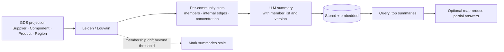

**Context assembly format (what the LLM actually sees)**

```text
[GRAPH p_0012] SUP-001 -SUPPLIES-> COMP-001 -USED_IN-> PROD-001 <-MANUFACTURES- MFG-001 (authority: erp_import)
[SQL sf_3]     COMP-001: on_hand=14400, avg_daily_consumption=1200 (as_of 2026-11-20)
[DOC ch_88 p.7] "...either party may suspend performance under force majeure..." (document_extraction, unverified)
```

**Honest signals instead of one opaque "confidence".** Responses expose *retrieval relevance*, *extraction confidence*, *authority level* and *faithfulness check result* separately. Below a calibrated rerank threshold the system **abstains** with "insufficient evidence".

**Tech stack for this component**

| Technology | Role | Why this | Main con |
|---|---|---|---|
| **Router (rules + small LLM classifier)** | Pick retrieval strategy | Avoids the cost and noise of running everything | Misrouting is a new failure class; must be benchmarked and traced |
| **pgvector HNSW** | Dense retrieval | Metadata filters in the same SQL | Recall depends on `ef_search` and filter selectivity |
| **PostgreSQL full-text (`tsvector`)** | Lexical retrieval | No extra service | **`ts_rank` is not true BM25.** If lexical quality matters, evaluate an in-app BM25 or a PostgreSQL BM25 extension against it |
| **Neo4j + Cypher templates** | Local graph retrieval | Native traversal, explainable paths | Depth explosion and hub nodes need caps; graph errors propagate |
| **Neo4j GDS** | Communities, centrality | Built-in algorithms | Edition limits and in-memory projections; partitions are non-deterministic |
| **BGE cross-encoder reranker** | Precision at top-K | Large precision gain over bi-encoder scores in common practice | Latency scales with candidates; truncates long inputs; serialized graph paths may score oddly |
| **LLM** | Generation with citations | Fluent synthesis | Cost, latency, non-determinism even at temperature 0 |

---

### 5.5 Agentic Orchestration

**Why it exists.** Investigations are multi-step: plan, traverse, read contracts, compute, compare, check, report. A single prompt cannot do that reliably. But unrestricted agents are unsafe and unevaluable. The design answer is **specialised agents with narrow, typed, read-only tools and an explicit state machine**.

**Orchestration graph**

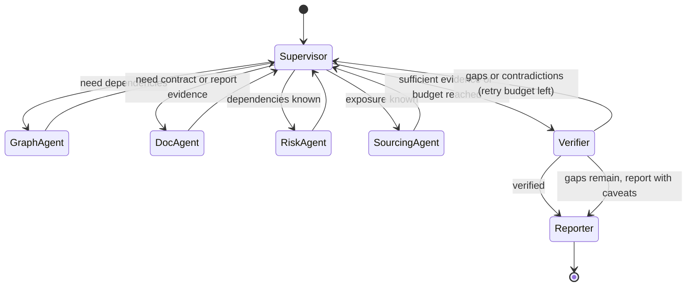

**Agent roster**

| Agent | Responsibility | Tools | Hard boundary |
|---|---|---|---|
| **Supervisor** | Classify intent, plan, route, judge sufficiency | none (routing only) | Cannot query data; cannot exceed budget |
| **Graph Investigation** | Dependency discovery | `find_supplier`, `traverse_dependencies`, `find_downstream_products`, `find_alternative_paths`, `get_supplier_relationships` | Templates only; hop ≤ server cap |
| **Document Research** | Contract and report evidence | `search_contracts`, `retrieve_supplier_reports`, `search_disruption_reports`, `extract_contract_constraints` | Tenant + ACL filtered; treats text as **untrusted data** |
| **Risk Analysis** | Exposure and criticality | `calculate_supplier_exposure`, `calculate_dependency_criticality`, `estimate_disruption_impact`, `calculate_risk_score` | Calls deterministic services only |
| **Alternative Sourcing** | Candidate filtering and ranking | `find_alternative_suppliers`, `compare_supplier_capacity`, `compare_lead_times`, `evaluate_sourcing_options` | Can never label a supplier "approved" |
| **Verification** | Validate claims, maths, citations, contradictions | `fetch_evidence`, `recompute_calculation`, `check_citation_support` | Can reject, cannot invent evidence |
| **Report Generation** | Structured report | `render_report` | Only includes findings with evidence or a labelled assumption |

**The tool sandbox: from LLM intent to database, with five checkpoints**

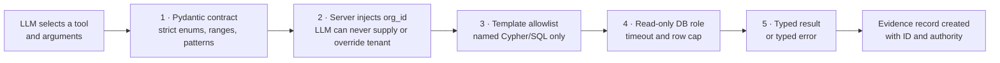

```python
class TraverseDependenciesInput(BaseModel):
    supplier_id: str = Field(..., pattern=r"^[A-Z]{3}-\d{3,}$")
    direction: Literal["downstream", "upstream"] = "downstream"
    max_hops: int = Field(3, ge=1, le=5)
    min_authority: Literal["human_verified", "erp_import",
                           "document_extraction", "llm_inferred"] = "document_extraction"
    limit: int = Field(200, ge=1, le=500)
```

Tool rules: idempotent reads · default 10 s timeout · typed errors (`NOT_FOUND`, `TIMEOUT`, `TRUNCATED`) · no retry on `NOT_FOUND`.

**Investigation state (conceptual).** The state carries `evidence` and `findings` as append-only lists. A finding is `fact | assumption | estimate | recommendation | gap` and must reference evidence IDs.

```python
class InvestigationState(TypedDict):
    investigation_id: str
    org_id: str                       # from the token, never from the LLM
    plan: list[str]
    scenario: dict | None             # assumptions, labelled SIMULATION
    entities: dict[str, dict]
    evidence: Annotated[list[Evidence], add]
    findings: Annotated[list[Finding], add]
    verification: dict | None
    budget: dict                      # steps_left, tokens_left, deadline
    retries: dict[str, int]
    next: str
```

**Budgets, retries, termination, fallback**

| Concern | Rule |
|---|---|
| **Budgets** | Max steps, tokens, wall-clock seconds and graph depth per investigation |
| **Retries** | Max 2 per node, exponential backoff for tool errors |
| **Termination** | All objectives verified, **or** budget exhausted, **or** verifier retries exhausted (report with explicit gaps) |
| **Fallback** | If the supervisor fails twice, a fixed linear workflow runs: Graph → Docs → Risk → Sourcing → Verify → Report |
| **Persistence** | PostgreSQL-backed LangGraph checkpointer, so runs resume after worker restarts |

**Sequence of a standard investigation**

```mermaid
sequenceDiagram
    actor U as Analyst
    participant API as FastAPI
    participant Q as Celery
    participant SUP as Supervisor
    participant GA as Graph agent
    participant DA as Doc agent
    participant RA as Risk agent
    participant SA as Sourcing agent
    participant VA as Verifier
    participant RP as Reporter
    U->>API: POST /investigations
    API-->>U: 202 Accepted + id
    API->>Q: enqueue run
    Q->>SUP: start workflow
    SUP->>GA: resolve supplier, traverse downstream
    GA-->>SUP: paths + entities
    SUP->>DA: fetch contracts and reports
    DA-->>SUP: chunks + constraints
    SUP->>RA: compute exposure
    RA-->>SUP: deterministic results
    SUP->>SA: find alternatives
    SA-->>SUP: ranked candidates
    SUP->>VA: verify all findings
    VA-->>SUP: pass or flags
    SUP->>RP: generate report
    U->>API: GET /investigations/id/events (SSE)
    API-->>U: step events, completion
```

**Tech stack for this component**

| Technology | Role | Why this | Main con |
|---|---|---|---|
| **LangGraph** | Stateful agent graph, checkpoints, conditional routing | Explicit state machine, resumable, inspectable; fits supervisor + workers | Young and fast-moving API (pin and wrap behind an adapter); checkpoint schemas need migration care; debugging graph state takes tooling |
| **Pydantic tool contracts** | Typed, validated tool I/O | Rejects malformed calls mechanically | Schema drift between tools and prompts must be tested |
| **Postgres checkpointer** | Durable run state | Reuses existing DB | Checkpoint growth needs retention policy |
| **Langfuse** | Agent, tool and retrieval tracing | One trace per investigation with cost | Self-hosting has several dependencies; cloud sends prompts to a third party |
| **Fake / recorded LLM** | Deterministic CI | No network in default CI | Recorded traces go stale as prompts change |

**Failure modes:** agent loops burning tokens (step and token budgets) · prompt injection through documents (untrusted-data handling, no side-effect tools, injection test corpus) · wrong tool choice (tool-selection accuracy tracked in the benchmark) · verifier false negatives (injected-error tests).

---

### 5.6 Risk and Scenario Engine

**Why it exists.** Prioritisation and impact numbers must be **explainable and reproducible**. This engine is pure, versioned, LLM-free code. It gives the agents reliable tools and gives the UI a "why is this score 78?" answer.

**Supplier risk score**

```mermaid
flowchart LR
    C["C · Concentration<br/>w=0.30"] --> R["R = w1·C + w2·D + w3·G + w4·O<br/>0–100, methodology_version stored"]
    D["D · Dependency criticality<br/>w=0.30"] --> R
    G["G · Geographic exposure<br/>w=0.20"] --> R
    O["O · Operational disruption<br/>w=0.20"] --> R
    R --> X["Factor breakdown persisted<br/>for explanation"]
```

| Factor | Initial definition | Normalization |
|---|---|---|
| **C** Concentration | Max share of any component's supply from this supplier; HHI per component | Percentile or linear 0–100 |
| **D** Dependency criticality | Criticality-weighted downstream product count; single-source flag | Min–max per tenant |
| **G** Geographic exposure | Region risk level × share of supply from the region | Reference table |
| **O** Operational disruption | Late-shipment rate, open disruption severity, contract-expiry proximity | Capped sub-scores |

> Weights are **illustrative, not industry-calibrated**. They live in versioned configuration. The score is a **relative prioritisation index, not a probability**.

**Calibration strategy:** sensitivity analysis on weights → rank-stability tests → expert pairwise review → fit on outcome data only if it exists; otherwise the score stays labelled *heuristic*.

**Graph metrics and where each one misleads**

| Metric | Use | Where it misleads |
|---|---|---|
| Degree | Highly connected suppliers | Counts edges, not criticality; commodity hubs look dangerous |
| Betweenness | Chokepoints | Expensive; depends on completeness; synthetic graphs distort |
| PageRank | Influence | Edge direction and weights must be meaningful; not a risk probability |
| Louvain / Leiden | Clusters | Non-deterministic partitions; resolution-sensitive |
| Shortest paths | Dependency chains | Shortest ≠ most important |
| Single points of failure | Components with one supplier | Misses *effective* single-source when alternatives are unqualified |

A supplier with few direct customers can still be critical if its component feeds many products. A direct-customer count would miss it; the graph does not.

**Scenario simulation (deterministic v1)**

```mermaid
flowchart TD
    I["Inputs: supplier, duration_days, capacity_reduction_pct,<br/>start_date, optional overrides"] --> A["Components supplied<br/>(graph)"]
    A --> B["Per component:<br/>supply_share, daily_demand, on_hand<br/>(SQL)"]
    B --> C["lost_daily = demand × share × reduction%"]
    B --> D["cover_days = on_hand / daily_demand"]
    C --> E["shortfall_days = max(0, duration − cover_days)"]
    D --> E
    E --> F["shortfall_units = lost_daily × shortfall_days"]
    F --> G["Fan out to products, manufacturers, open shipments"]
    G --> H["Result labelled SIMULATION<br/>with assumptions list"]
```

**Worked example** *(illustrative numbers, matches the scenario in [§3.4](#34-end-to-end-scenario))*

| Quantity | Value | Source |
|---|---|---|
| `on_hand` for `COMP-001` | 14,400 units | SQL snapshot |
| `daily_demand` | 1,200 units/day | trailing 90-day average (assumption) |
| `supply_share` of `SUP-001` | 100% | `supplier_components` |
| `capacity_reduction_pct` | 100% | scenario input |
| `cover_days` | 14,400 / 1,200 = **12 days** | derived |
| `shortfall_days` | max(0, 30 − 12) = **18 days** | derived |
| `lost_daily` | 1,200 × 1.0 × 1.0 = 1,200 units/day | derived |
| `shortfall_units` | 1,200 × 18 = **21,600 units** | derived, `SCENARIO_ESTIMATE` |

**Property tests (Hypothesis):** longer duration never reduces shortfall · more inventory never increases shortfall · 0% reduction yields 0 shortfall · every output carries `label: SIMULATION`.

**Known v1 simplifications:** constant demand · no in-transit inventory unless modelled · no recovery curve · alternative-supply ramp ignored (v1.1 adds lead-time-delayed alternatives). **Monte Carlo** (future) needs documented distributions and reports percentile bands. No output is ever called a *prediction*.

**Tech stack for this component**

| Technology | Role | Why this | Main con |
|---|---|---|---|
| **Pure Python domain services** | Risk, impact, sourcing | Testable, no I/O, no LLM | Needs discipline to keep I/O out of `domain/` |
| **Hypothesis** | Property tests | Finds edge cases for monotonicity rules | Slower runs; generators take effort |
| **Neo4j GDS** (*fallback: NetworkX*) | Centrality, communities | Native speed on the graph | Edition limits; NetworkX only suits synthetic scale |
| **Pydantic** | Typed scenario inputs and outputs | Validated, serializable | None significant |

---
### 5.7 Alternative Supplier Intelligence

**Why it exists.** After "what breaks?" comes "what instead?". Ranking suppliers by a blended score without enforcing hard constraints produces recommendations that cannot actually be executed. This component applies **constraints first, scores second, sensitivity third**, and never claims approval.

```mermaid
flowchart TD
    A["Component + product requirements"] --> B["Candidate pool<br/>graph + supplier catalog"]
    B --> C["Hard-constraint filter"]
    C --> D{"Any candidates?"}
    D -- No --> E["Report: no feasible alternative<br/>list which constraints failed"]
    D -- Yes --> F["Normalize criteria<br/>min–max over feasible set"]
    F --> G["Weighted multi-criteria score"]
    G --> H["Sensitivity check<br/>perturb weights ±10%"]
    H --> I["Rank + evidence + caveats"]
```

| Stage | Contents |
|---|---|
| **Hard constraints (filter)** | Spec compatibility · capacity ≥ required volume with headroom · lead time ≤ maximum · region not excluded (sanctions, policy, risk threshold) · required certifications · no contract exclusivity conflict |
| **Soft criteria (rank)** | Unit cost · lead time · on-time reliability · supplier risk score · diversification gain · existing relationship · qualification effort |
| **Score** | `Score(s) = Σ wᵢ · normᵢ(s)`, weights configurable, UI shows live re-ranking |

**Status vocabulary (never exceeded without human action)**

```mermaid
flowchart LR
    A["CANDIDATE_NOT_QUALIFIED<br/>identified by the system"] --> B["UNDER_EVALUATION<br/>human started qualification"]
    B --> C["QUALIFIED<br/>set only by a human in the source system"]
```

Every recommendation lists its evidence and distinguishes **verified** from **self-reported** attributes (for example, a capacity figure from a supplier brochure).

| Technology | Role | Why this | Main con |
|---|---|---|---|
| **Pure Python scoring + Pydantic** | Constraint matrix, ranking, sensitivity | Deterministic, unit-testable | Weights are subjective; need sensitivity analysis and expert review |
| **Neo4j** | Compatibility and `ALTERNATIVE_TO` paths | Natural fit for substitution graphs | `ALTERNATIVE_TO` edges are often `llm_inferred`, so authority filters apply |

---

### 5.8 API and Backend Application

**Why it exists.** The backend is where tenancy, authorization, validation, budgets and transaction boundaries are enforced once, so that no UI, agent or worker can bypass them. It is a **modular monolith**: one deployable, strict internal layering.

**Layering**

```mermaid
flowchart TD
    R["API routers<br/>HTTP, validation, auth dependencies"] --> A["Application services<br/>use cases, own the transaction"]
    A --> D["Domain services (pure)<br/>risk, impact, sourcing"]
    A --> G["GraphRAG + agent services"]
    A --> P["Repository interfaces"]
    D --> P
    G --> P
    P --> I["Infrastructure adapters<br/>SQLAlchemy, Neo4j driver, S3, Redis, LLM clients"]
```

| Layer | Must do | Must not |
|---|---|---|
| Routers | Validate, authenticate, map errors | Contain business logic or queries |
| Application services | Orchestrate, own transactions | Know about HTTP |
| Domain services | Deterministic logic | Call LLMs or know storage |
| Repositories | Tenant-scoped, parameterized access | Make business decisions |
| Agents / GraphRAG | Use services through typed tools | Touch the database directly |
| Workers | Execute application services | Duplicate logic |

**Request pipeline**

```mermaid
flowchart LR
    A["Request"] --> B["request_id +<br/>structured logging"]
    B --> C["JWT verify"]
    C --> D["Rate limit<br/>(Redis token bucket)"]
    D --> E["Tenant context<br/>org_id from token only"]
    E --> F["RBAC check"]
    F --> G["Pydantic validation"]
    G --> H["Application service"]
    H --> I["Domain exceptions →<br/>RFC 7807 problem response"]
```

**Async work pattern.** Long operations return `202 Accepted` with a resource URL; progress arrives via **SSE** with a polling fallback; `Idempotency-Key` guards job creation.

| Technology | Role | Why this | Main con |
|---|---|---|---|
| **FastAPI** | Async REST + SSE | Typed, OpenAPI for free, great Pydantic fit | Blocking calls inside `async` routes stall the loop; no built-in auth, admin or background durability |
| **Pydantic v2 + Settings** | Contracts, config, fail-fast startup | Same models for API, tools and LLM output | Validation overhead on hot paths; v1 → v2 migration friction in third-party libs |
| **SQLAlchemy 2 (async)** | Data access | Mature, typed | Async lazy-loading pitfalls; N+1 vigilance needed |
| **Argon2 + JWT** | Authn | Standard, stateless access tokens | Revocation is hard; short-lived access plus rotating refresh tokens |
| **httpx + pytest** | API testing | Async test client | None significant |

---

### 5.9 Frontend and Visualization

**Why it exists.** Trust is built in the UI. If a claim cannot be clicked through to its evidence, analysts will not use the answer. The frontend's job is to make **evidence, authority and uncertainty visible**, not just to look good.

**Page map**

```mermaid
flowchart LR
    CT["Control Tower"] --> SI["Supplier Intelligence"]
    CT --> RI["Risk Intelligence"]
    SI --> GE["Graph Explorer"]
    GE --> IW["Investigation Workspace"]
    RI --> IW
    IW --> RP["Reports"]
    IW --> SIM["Disruption Simulator"]
    SIM --> ALT["Alternative Comparison"]
    ALT --> RP
    DM["Document Management"] -.-> GE
    ADM["Administration"] -.-> CT
```

**Data flow of an investigation in the UI**

```mermaid
flowchart LR
    A["Start investigation<br/>POST /investigations"] --> B["EventSource (SSE)<br/>agent step events"]
    B --> C["TanStack Query cache<br/>server state"]
    C --> D["Agent timeline<br/>React Flow"]
    C --> E["Evidence panel<br/>paths, chunks, SQL facts"]
    F["Zustand<br/>selection, filters, UI state"] --> E
    E --> G["Cytoscape.js<br/>highlight cited paths"]
    B -. "fallback" .-> H["Polling"]
```

| Page | Key elements |
|---|---|
| **Control Tower** | KPIs (suppliers, high-risk count, active disruptions, single-source components), regional risk heatmap, top risks, recent investigations |
| **Supplier Intelligence** | Filterable table; detail with risk factor breakdown, contracts, components, shipments, graph mini-view |
| **Graph Explorer** | Focus + expand; filter by relation type, authority and hops; provenance side panel; path finder; community overlay |
| **Investigation Workspace** | Query + scenario parameters; live agent timeline; evidence panel; hover-linked citations; Facts / Assumptions / Estimates tabs |
| **Risk Intelligence** | Rankings, "why is this score 78?", geographic concentration, SPOF list |
| **Disruption Simulator** | Supplier picker, duration and capacity sliders, impact graph, scenario compare, permanent `SIMULATION` badge |
| **Alternative Comparison** | Constraint pass/fail matrix, criteria table, weight sliders with live re-ranking, "candidate, not approved" labelling |
| **Documents / Reports / Admin** | Upload and job status, chunk preview, rendered cited report and export, users, audit log, usage and cost |

**UX rules.** Every claim is clickable to evidence · authority badges (ERP / Document / Inferred / Verified) · scenario output always badged `SIMULATION` · typed error messages with `request_id` · large graphs capped with an "expand more" action and a truncation notice · colour is never the only encoding.

| Technology | Role | Why this | Main con |
|---|---|---|---|
| **React + TypeScript** | SPA | Ecosystem, type-safety with OpenAPI-generated clients | Tooling churn; discipline needed to avoid state sprawl |
| **Cytoscape.js** | Graph explorer | Canvas rendering and layout algorithms suit graphs | Performance degrades past a few thousand elements; heavy layouts block the main thread |
| **React Flow** | Agent workflow view | Ideal for node-and-edge flow diagrams | DOM-based, so unsuitable for large graphs |
| **TanStack Query + Zustand** | Server state / UI state | Simple, small | Two state systems demand clear ownership rules |
| **Tailwind CSS** | Styling | Fast, consistent | Class noise without component discipline |
| **Recharts / ECharts** | Charts | Quick dashboards | Large datasets need server-side aggregation |
| **Playwright** | E2E tests | Reliable cross-browser | SSE and async flows can be flaky without careful waits |

---

### 5.10 Observability and Evaluation Loop

**Why it exists.** LLM systems fail quietly: a plausible wrong answer raises no exception. You can only improve what you can **trace** and **measure**. This component closes the loop from production failure to regression test.

```mermaid
flowchart LR
    APP["FastAPI + workers + agents"] -->|"OpenTelemetry traces"| OT["OTel collector (optional)"]
    APP -->|"LLM, retrieval and agent spans"| LF["Langfuse"]
    APP -->|"/metrics"| PR["Prometheus"]
    APP -->|"JSON logs"| LG["Log aggregation"]
    PR --> GF["Grafana dashboards and alerts"]
    LF --> EV["Eval datasets and scores"]
    PG[("Postgres, Neo4j, Redis exporters")] --> PR
```

**The improvement loop**

```mermaid
flowchart LR
    F["Failure or alert"] --> T["Open Langfuse trace<br/>by investigation_id"]
    T --> I["Inspect retrieval context<br/>and tool calls"]
    I --> R["Reproduce with recorded trace<br/>in test harness"]
    R --> B["Add case to benchmark"]
    B --> X["Fix and re-run benchmark"]
    X --> V{"Regression?"}
    V -- No --> S["Ship"]
    V -- Yes --> I
```

| Signal | Implementation |
|---|---|
| **Structured logs** | JSON with `request_id`, `org_id`, `investigation_id`, `agent`, `tool`; PII scrubbing |
| **Tracing** | OpenTelemetry from API to Celery to DB; trace IDs propagated through task headers |
| **LLM traces** | One trace per investigation; spans for agents, tools, retrieval, LLM calls; prompt version, model, tokens, cost, latency; faithfulness and citation scores attached |
| **Retrieval traces** | Router decision, candidates per retriever, fusion and rerank scores, final context IDs |
| **Metrics** | HTTP latency histograms, Celery queue depth, **outbox oldest-pending age**, Neo4j and pgvector latency, LLM tokens and cost, cache hit rate |
| **Alerts** *(thresholds from measured baselines)* | Outbox age · dead-letter count > 0 · investigation failure rate · p95 breach · LLM spend rate · reconciliation drift > 0 · readiness failing |

| Technology | Role | Why this | Main con |
|---|---|---|---|
| **Langfuse** | LLM tracing and evaluation datasets | Purpose-built for agent traces and cost | Self-host stack has several dependencies; cloud sends prompts out of your boundary |
| **OpenTelemetry** | Vendor-neutral tracing | Cross-service context propagation | Instrumentation effort across async and Celery boundaries |
| **Prometheus + Grafana** | Metrics, dashboards, alerts | Standard, flexible | High-cardinality labels (for example, `org_id`) can blow up storage |
| **RAGAS + custom harness** | Faithfulness, context precision, plus domain metrics (path recall, task completion) | Standard LLM-eval metrics plus supply-chain-specific ones | LLM-judge bias and cost; must be calibrated against human labels |
| **Sentry** *(optional)* | Exceptions | Fast triage | Another SaaS and data-egress consideration |

---

### 5.11 Security and Tenancy

**Why it exists.** The platform ingests untrusted documents, passes them to LLMs that can call tools, and serves multiple organizations from one schema. Each of those is a classic way to leak data or lose control. Controls are **layered** so one failure does not become a breach.

**Defense in depth for tenant isolation**

```mermaid
flowchart TB
    A["1 · JWT carries org_id<br/>clients never pass it"] --> B["2 · Repository base class<br/>always applies tenant filter"]
    B --> C["3 · Optional PostgreSQL Row-Level Security"]
    C --> D["4 · Neo4j templates always include tenant predicate<br/>cross-tenant edges forbidden by validator"]
    D --> E["5 · Retrieval filters pushed into SQL/Cypher<br/>reranker and LLM only see filtered candidates"]
    E --> F["6 · Cross-tenant tests in CI<br/>cross-tenant IDs return 404, not 403"]
```

**Prompt-injection defense for retrieved text**

```mermaid
flowchart LR
    D["Retrieved document text"] --> W["Wrapped as UNTRUSTED DATA<br/>instruction hierarchy"]
    W --> L["LLM extracts or summarizes only"]
    L --> V["Output schema validation"]
    V --> T{"Tool call requested?"}
    T -- "Tools chosen by plan, not by document content" --> OK["Allowed: read-only typed tools"]
    T -- "Side-effect request" --> NO["No such tool exists in MVP"]
```

| Threat | Control |
|---|---|
| **Cross-tenant data access** | Layers above; mandatory isolation tests |
| **Prompt injection via documents** | Untrusted-data framing, schema-validated outputs, no side-effect tools, injection test corpus that must never trigger forbidden calls |
| **Cypher / SQL injection** | Parameterized templates only; labels and relationship types from allowlists, never interpolated from user or LLM text; agents cannot submit raw queries |
| **Malicious uploads** | Size and MIME checks, archive-bomb protection, sandboxed parsing without network, optional AV scan |
| **Runaway agents or cost** | Step, token, time and depth budgets; per-org daily LLM budget; rate limits (stricter on LLM routes) |
| **Hallucinated facts** | Mandatory evidence IDs, verifier, abstention path, deterministic numbers |
| **Secrets exposure** | Env or secrets manager only; never in logs, images or repo |
| **Repudiation** | Append-only audit log for auth, uploads, investigations, verifications, config changes |
| **Data retention / PII** | Configurable retention; deletion propagates to chunks, vectors and graph edges; optional redaction before LLM calls |

**Insight vs. recommendation.** An *insight* is traceable to specific graph paths, records or passages and is recomputable. A *recommendation* is model-synthesized, depends on assumptions and judgement, and is **always labelled as such**.

---

### 5.12 Deployment and CI/CD

**Why it exists.** A portfolio product should start with one command and deploy through a pipeline, not a laptop. The aim is *reproducible and boring*, not maximal scale.

**Environment ladder**

```mermaid
flowchart LR
    L["Local<br/>docker compose up<br/>make seed"] --> CI["CI<br/>GitHub Actions<br/>Testcontainers"]
    CI --> ST["Staging<br/>single EC2 + managed data"]
    ST --> PR["Production-oriented<br/>RDS · S3 · Aura or self-hosted Neo4j"]
    PR -.-> EN["Larger enterprise<br/>ECS or EKS only if justified"]
```

**Pipeline**

```mermaid
flowchart LR
    PRN["Pull request"] --> LN["Lint: ruff"]
    LN --> TY["Types: mypy"]
    TY --> TE["Unit + integration tests"]
    TE --> SE["Security scan: Bandit, pip-audit, Trivy"]
    SE --> EV["Eval smoke subset<br/>if retrieval or agents changed"]
    EV --> BU["Build images"]
    BU --> MG{"Merge to main"}
    MG --> DS["Deploy staging"]
    DS --> SM["Smoke tests"]
    SM --> AP{"Manual approval"}
    AP --> DP["Deploy production<br/>gated migration with backup"]
```

```mermaid
flowchart TB
    U["Users"] --> CF["DNS + TLS"]
    CF --> NG["Nginx / ALB"]
    subgraph VPC["AWS VPC"]
        subgraph Pub["Public subnet"]
            NG
        end
        subgraph Priv["Private subnet"]
            API["FastAPI containers"]
            WK["Celery workers + beat"]
            RD[("Redis")]
        end
        subgraph DataS["Managed data (never public)"]
            RDS[("RDS PostgreSQL + pgvector")]
            N4[("Neo4j Aura / self-hosted")]
            S3[("S3")]
        end
        SM["Secrets Manager"]
    end
    NG --> API
    API --> RDS
    API --> N4
    API --> RD
    WK --> RDS
    WK --> N4
    WK --> S3
    API --> SM
    API --> LLM["LLM and embedding APIs"]
```

| Topic | Approach |
|---|---|
| **Containers** | Multi-stage builds, non-root user, pinned base images, image scanning |
| **Config** | 12-factor environment variables; secrets from AWS Secrets Manager in cloud |
| **Health** | `/health/live` (process) and `/health/ready` (PostgreSQL, Neo4j, Redis reachable, migrations current) |
| **Backups** | RDS PITR; Neo4j scheduled backups with a **documented rebuild-from-PostgreSQL path**; S3 versioning; restore drill executed before "deployment ready" |
| **Scaling** | API and workers scale independently; queue-based backpressure; GDS jobs scheduled off-peak |
| **Kubernetes** | Not adopted unless measured need justifies the operational cost |

| Technology | Role | Why this | Main con |
|---|---|---|---|
| **Docker Compose** | Local and single-host deploy | One-command reproducibility | No autoscaling or rolling deploys; Neo4j, PostgreSQL and workers compete for one host's RAM |
| **GitHub Actions** | CI/CD | Integrated | Heavy integration suites consume minutes; fork PRs and secrets need care |
| **AWS (EC2/ECS, RDS, S3, Secrets Manager)** | Hosting | Common, managed data services | Cost and IAM complexity; mitigate with IaC (Terraform or CDK) |
| **Nginx / ALB** | TLS, routing | Standard | SSE needs proxy buffering disabled and longer timeouts |

---

## 6. Technology Stack Trade-offs

This section exists because **a stack choice is only credible when its costs are stated.** Each technology below lists why it was chosen, its real cons, and how the project contains the risk. Where a claim depends on a version or edition, it is marked **verify** and must be checked in Phase 0 ([§11](#11-roadmap)).

### 6.1 The ten biggest cons in one table

| # | Con | Severity | Where it bites | Containment |
|---|---|---|---|---|
| 1 | **Three data stores = three failure modes** and a permanent synchronization burden | 🔴 High | Drift between graph, vectors and records | Outbox, idempotent consumers, reconciliation, rebuild script, runbooks |
| 2 | **Eventual consistency**: the graph can lag the source of truth | 🔴 High | Investigation uses stale relationships | Graph watermark recorded per investigation; lag notice in UI; lag alert |
| 3 | **LLM extraction errors pollute the graph** and errors propagate along paths | 🔴 High | A hallucinated `SUPPLIES` edge inflates exposure | Evidence span required, confidence gate, authority ladder, `min_authority` filter, steward verification, edge audits |
| 4 | **Neo4j edition and GDS limits** (Community edition lacks features such as multi-database tenancy and online backup; GDS Community has restrictions) **verify** | 🔴 High | Tenant isolation design, backups, algorithm availability | `uid` embeds the tenant, rebuild-from-PostgreSQL recovery, NetworkX fallback |
| 5 | **Agent cost and latency**: multi-agent runs make many LLM calls and take minutes | 🟠 Medium-High | Spend, UX, rate limits | Budgets, small models for routing, caching, SSE progress, fixed fallback workflow |
| 6 | **LangGraph / LangChain API churn** | 🟠 Medium-High | Upgrades break workflows | Pin versions, thin adapter layer, fake-LLM contract tests |
| 7 | **pgvector is not a dedicated search engine**: filtered-ANN recall loss, HNSW memory cost, no true BM25 | 🟠 Medium | Retrieval quality at scale | Benchmark recall under filters, tune `ef_search`, evaluate a BM25 alternative |
| 8 | **Synthetic-data benchmark limits external validity** | 🟠 Medium | Results may not transfer to real data | Label everywhere; planted noise, aliases and conflicts; never claim real-world performance |
| 9 | **Solo-developer scope**: the surface area is very large | 🟠 Medium | Quality dilution | Phase gates, MVP first, cut Advanced features rather than quality |
| 10 | **LLM provider dependency**: outages, deprecation, drift, data egress | 🟡 Medium | Availability and confidentiality | Provider abstraction, pinned model IDs, local-model fallback for dev, redaction option |

### 6.2 Quadrant: value vs. operational cost (author's judgement)

```mermaid
quadrantChart
    title Technology choices: value vs operational cost (judgement, not measured)
    x-axis Low operational cost --> High operational cost
    y-axis Lower project leverage --> Higher project leverage
    quadrant-1 Invest and own carefully
    quadrant-2 Easy wins
    quadrant-3 Nice to have
    quadrant-4 Question each one
    PostgreSQL: [0.25, 0.9]
    FastAPI and Pydantic: [0.2, 0.8]
    pgvector: [0.3, 0.65]
    Redis: [0.25, 0.4]
    Celery: [0.5, 0.55]
    Neo4j: [0.7, 0.9]
    GDS communities: [0.75, 0.5]
    LangGraph: [0.6, 0.75]
    Cross-encoder rerank: [0.5, 0.5]
    Langfuse: [0.55, 0.6]
    Kubernetes: [0.95, 0.15]
```

### 6.3 Backend, data and messaging

| Technology (role) | Why chosen | Real cons | Mitigation / exit ramp |
|---|---|---|---|
| **Python 3.12** (language) | Dominant AI and data ecosystem; strong typing with mypy | GIL limits CPU-bound parallelism; some ML libraries lag new Python versions; slower than compiled languages for hot loops | CPU-heavy work in separate worker processes; pin and test the full matrix in Phase 0; move hot paths to a compiled extension only if measured |
| **FastAPI** (API) | Async, typed, automatic OpenAPI, SSE support | Easy to block the event loop with sync calls; no batteries (admin, auth, ORM); dependency graph can become opaque; built-in background tasks are not durable | Sync work to Celery or thread pool; explicit auth module; durable jobs via Celery; consider Django REST only if an admin-heavy product emerges |
| **Pydantic v2** (contracts) | One validation layer for API, tools, LLM output, config | Hot-path overhead; provider structured-output supports only part of JSON Schema; ecosystem still has v1 stragglers | Keep LLM output schemas simple and flat; benchmark hot paths; avoid unmaintained v1-only libs |
| **SQLAlchemy 2 + Alembic** (data access) | Mature, typed, async engine | Async lazy-loading errors; N+1 risks; autogenerate misses partial indexes, custom types (vector) and data migrations | Explicit eager loading; mandatory migration review; migration up/down tests on Testcontainers |
| **PostgreSQL** (truth) | ACID, JSONB, FTS, RLS, one transaction for row and outbox | Single-writer scaling; outbox churn causes bloat; RLS adds subtle complexity with pooled connections | Outbox retention and vacuum tuning, partitioning later; test RLS under the real pooling mode; read replicas only on measured need |
| **pgvector** (dense retrieval) | One DB, one transaction, SQL filters for tenant and ACL | Filtered ANN can reduce recall; HNSW builds need memory and time; HNSW has a dimension ceiling **verify against installed version**; re-embedding on model change is costly | Measure recall under real filters; tune `ef_search`; partition by tenant if needed; exit ramp: a dedicated vector engine behind the same retriever interface |
| **PostgreSQL FTS** (lexical) | No extra service | `ts_rank` is not BM25; weak for part numbers and fuzzy matches | Benchmark against an in-app BM25 or a BM25 extension; exact IDs also resolved via graph lookup |
| **Neo4j** (graph) | Cypher, native traversal, GDS, visualization ecosystem | Extra ops surface; Community edition limits **verify**; page-cache and memory tuning; supernode traversal cost; Cypher is not fully portable | Tenant-embedded `uid`; fan-out caps; rebuild script; keep graph logic behind repository interfaces so a GQL-compatible store could replace it |
| **Neo4j GDS** (analytics) | Production-grade algorithms | Edition and concurrency limits **verify**; in-memory projections must fit RAM; community partitions vary run to run | Schedule off-peak; fix random seeds where supported; NetworkX offline fallback at synthetic scale |
| **Redis** (broker, cache) | Simple, fast, familiar | Memory-bound; durability is optional; licensing terms changed across versions **verify** (Valkey is a drop-in alternative) | Nothing authoritative lives in Redis; outbox lives in PostgreSQL |
| **Celery** (jobs) | Mature retries, scheduling, routing | Tasks are synchronous by design (async code needs bridging); heavy configuration; at-least-once redelivery duplicates work | Idempotency everywhere; keep tasks thin, calling application services; alternatives: Arq, Dramatiq; **Temporal** if workflows outgrow Celery |
| **S3 / MinIO** (objects) | Cheap immutable storage, S3 API portability | Extra local service; MinIO edition and licence changes **verify** | Abstract behind a storage interface; LocalStack or moto in tests |
| **Argon2 + JWT** (auth) | Standard, stateless | Hard to revoke access tokens; HS256 shares one secret | 15-minute access tokens, rotating refresh tokens, move to asymmetric keys when more than one verifier exists |

### 6.4 AI, retrieval and agents

| Technology (role) | Why chosen | Real cons | Mitigation / exit ramp |
|---|---|---|---|
| **LangGraph** (agents) | Explicit state machine, conditional routing, checkpointing, resumable | Young and changing API; state schema and checkpoint migrations; harder debugging than plain functions; ties you toward the LangChain ecosystem | Pin versions; wrap in an adapter; keep the fixed linear fallback so the system works without the supervisor; custom state machine remains an exit |
| **LangChain** (core pieces only) | Loaders and model wrappers save time | Abstraction churn; hidden prompts; heavy dependency tree | Use only thin integrations; call provider SDKs directly where clarity matters |
| **LLM APIs** (extraction, planning, synthesis) | Best available language understanding | Cost; seconds of latency per call; non-deterministic even at temperature 0; deprecations; contracts and supplier data leave your boundary | Provider abstraction; budgets and caching; small models for classification; redaction option; local models (Ollama or vLLM) for dev |
| **Embedding models** (OpenAI or BGE) | Strong semantic recall | Dimension locks the schema (`VECTOR(n)`); changing models forces full re-embedding; part numbers embed poorly | Version embeddings by model ID; keep lexical and graph retrieval for IDs; fail-fast config check on `EMBEDDING_DIM` |
| **BGE cross-encoder reranker** | Better precision at top-K | Latency scales with candidates; inputs truncated; CPU inference is slow; graph paths serialized to text may rank oddly | Rerank 40 → 10 only; GPU or batching if needed; evaluate with and without as an ablation |
| **Community summaries** (global retrieval) | Answers corpus-level questions | LLM-generated summaries cost money, go stale, and can embed errors | Version and flag stale; regenerate on drift threshold; cite member lists |
| **RAGAS** (evaluation) | Standard faithfulness and context metrics | LLM-judge bias and cost; metric instability across judge models | Calibrate on human-labelled samples; pin the judge model; report human spot-checks |

### 6.5 Frontend, delivery and operations

| Technology (role) | Why chosen | Real cons | Mitigation / exit ramp |
|---|---|---|---|
| **React + TypeScript** | Ecosystem, typed API clients from OpenAPI | Build-tool churn; easy to over-engineer state | Typed generated client; clear state ownership rules |
| **Cytoscape.js** | Purpose-built graph rendering and layouts | Slows past a few thousand elements; layouts are CPU-heavy | Server-side caps and truncation notices; progressive expansion; Sigma.js (WebGL) as an exit |
| **React Flow** | Agent workflow diagrams | DOM-based, not for large graphs | Use only for small workflow views |
| **TanStack Query + Zustand** | Lightweight server and UI state | Two systems to keep conceptually separate | Rule: server data in Query, ephemeral UI state in Zustand |
| **Docker Compose** | Reproducible single-host stack | No autoscaling or rolling updates; single-host RAM contention; weak secrets story | Managed data services in cloud; secrets from Secrets Manager; ECS later if justified |
| **AWS** | Managed data, common skill | Cost and IAM complexity; lock-in | IaC; containerized workloads stay portable |
| **Langfuse** | LLM-native tracing and evals | Self-hosting needs multiple services **verify current architecture**; cloud mode exports prompts | Redact before export; start on cloud with synthetic data; self-host for sensitive data |
| **Prometheus + Grafana** | Standard metrics stack | Label-cardinality blowups; alert tuning takes time | Avoid per-tenant labels on high-cardinality series; alert only from measured baselines |
| **pytest + Testcontainers + Hypothesis** | Real-database integration tests | Slow CI from container start-up; Docker needed in CI | Parallel jobs, reusable containers locally; keep unit tests container-free |
| **Playwright** | Reliable E2E | Flaky with SSE and async if waits are naive | Wait on events, not sleeps; run nightly rather than per PR |

### 6.6 Architectural decisions, costs and when to revisit

| Decision | Benefit | Cost | Revisit when |
|---|---|---|---|
| **Modular monolith** | One deploy, simple debugging, fast iteration | Coupled releases; discipline needed to keep layers clean | Multiple teams or independently scaling components |
| **Neo4j as a derived projection** | Rebuildable; PostgreSQL stays authoritative | Sync machinery and lag | Graph becomes the primary write path |
| **pgvector instead of a vector DB** | One transaction, simple ops | Recall and scale ceilings | Corpus size or filtered-recall metrics outgrow it |
| **Outbox + Celery instead of Kafka** | Simple, durable, transactional | Lower throughput ceiling; polling relay | Sustained event volume or multiple independent consumers |
| **Deterministic engines outside the LLM** | Reproducible, testable numbers | More code to write | Never; this is a core principle |
| **Router instead of run-everything** | Lower cost and noise | Misrouting risk | Router accuracy measured below target |
| **Read-only agents** | Safe by construction | Cannot automate actions | Human-approval workflow is built ([§13](#13-acceptance-limitations-and-future-work)) |

### 6.7 Alternatives considered and why not now

| Alternative | Attractive because | Not chosen because | Would be right if… |
|---|---|---|---|
| **PostgreSQL only** (recursive CTEs, optionally a graph extension) | One fewer store, no sync | Weaker multi-hop ergonomics, no GDS-style algorithms, weaker graph visualization ecosystem | The graph stays small and traversals shallow |
| **Dedicated vector DB** (Qdrant, Weaviate) | Better filtered ANN and hybrid features | Fourth datastore, another sync path | pgvector fails the retrieval benchmark under real filters |
| **Kafka** | Durable event log, many consumers | Operational overhead exceeds benefit at this scale | Several independent downstream consumers appear |
| **Microservices** | Independent scaling | Premature for one developer | Teams and scaling needs diverge |
| **Kubernetes** | Orchestration at scale | Operational overhead | Multi-service autoscaling is measured as necessary |
| **Temporal** (durable workflows) | Best-in-class long-running workflows | New infrastructure | Investigations need guaranteed exactly-once semantics beyond LangGraph checkpoints |
| **Local-only open models** | Data stays in-house, fixed cost | Lower quality on extraction and planning in typical setups | Confidentiality rules forbid external APIs |

---
## 7. Knowledge Graph and Data Model

### 7.1 Entities and ownership

| Entity | Key properties | Unique ID | Authoritative store |
|---|---|---|---|
| Organization (tenant) | name, industry | `organization_id` (UUID) | PostgreSQL |
| Supplier | name, country, status, qualification_status, tier | `supplier_id` | PostgreSQL |
| Manufacturer | name, industry, location | `manufacturer_id` | PostgreSQL |
| Product | sku, name, category | `product_id` | PostgreSQL |
| Component | name, category, criticality (Low/Med/High/Critical), spec_ref | `component_id` | PostgreSQL |
| Warehouse / DistributionCenter | location, capacity | `warehouse_id` / `dc_id` | PostgreSQL |
| Shipment | status, expected_date, actual_date, qty | `shipment_id` | PostgreSQL |
| Route | origin, destination, mode, transit_days | `route_id` | PostgreSQL |
| Contract | start, expiry, terms_summary, min_volume | `contract_id` | PostgreSQL (+ document) |
| PurchaseOrder | qty, unit_price, due_date, status | `po_id` | PostgreSQL |
| Inventory | on_hand, safety_stock, as_of | composite | PostgreSQL |
| Region / Country | name, iso_code, risk_level, risk_source | `region_id` | Reference data |
| Disruption | type, severity, start, end, source, verified | `disruption_id` | PostgreSQL |
| RiskAssessment | score, methodology_version, factors | `assessment_id` | PostgreSQL |
| Document, Source | filename, checksum, version / reliability tier | `document_id`, `source_id` | PostgreSQL |
| Investigation | query, status, plan | `investigation_id` | PostgreSQL |

### 7.2 Graph schema

```mermaid
graph TD
    Supplier -->|SUPPLIES| Component
    Component -->|USED_IN| Product
    Manufacturer -->|MANUFACTURES| Product
    Manufacturer -->|SOURCES_FROM| Supplier
    Product -->|STORED_AT| Warehouse
    Shipment -->|SHIPS_FROM| Supplier
    Shipment -->|SHIPS_TO| Warehouse
    Shipment -->|FOLLOWS_ROUTE| Route
    Shipment -->|CARRIES| Component
    Supplier -->|LOCATED_IN| Region
    Manufacturer -->|LOCATED_IN| Region
    Warehouse -->|LOCATED_IN| Region
    Supplier -->|HAS_CONTRACT| Contract
    Contract -->|COVERS| Component
    Supplier -->|ALTERNATIVE_TO| Supplier
    Supplier -->|AFFECTED_BY| Disruption
    Region -->|AFFECTED_BY| Disruption
    Route -->|AFFECTED_BY| Disruption
    Contract -->|EVIDENCED_BY| Document
```

| Relationship | Pattern | Notes |
|---|---|---|
| `SUPPLIES` | Supplier → Component | `lead_time_days`, `capacity_per_month`, `share_pct`, `price_band` |
| `USED_IN` | Component → Product | `qty_per_unit` |
| `MANUFACTURES` | Manufacturer → Product | `capacity_per_month` |
| `STORED_AT` | Product → Warehouse | |
| `SHIPS_FROM` / `SHIPS_TO` / `FOLLOWS_ROUTE` / `CARRIES` | Shipment → Supplier / Warehouse or Manufacturer / Route / Component | `qty` on `CARRIES` |
| `LOCATED_IN` | Supplier, Manufacturer, Warehouse → Region | |
| `HAS_CONTRACT` / `COVERS` | Supplier → Contract / Contract → Component | |
| `SOURCES_FROM` | Manufacturer → Supplier | Operational purchasing relation, derived from POs |
| `ALTERNATIVE_TO` | Supplier → Supplier (or Component → Component) | `compatibility_status`, `evidence` |
| `AFFECTED_BY` | Entity → Disruption | `impact_basis` |
| `EVIDENCED_BY` | Any fact → Document or Chunk | Provenance link |
| `DEPENDS_ON` | **Derived and cached only** | Labelled `derived: true`; **never ground truth** |

**Modelling conventions**

1. One canonical edge per fact; **no stored inverse edges** (reverse direction in Cypher). `REQUIRES` is therefore not materialized; use `USED_IN` backwards.
2. `DEPENDS_ON` is derived analysis output, never an input.
3. Every node carries `organization_id`, `id`, `created_at`, `updated_at`.
4. Every relationship carries a `provenance` map.
5. IDs are stable business or UUID identifiers; **names are never keys**.
6. Prefer labels for entity types and properties for status; avoid label explosion.

### 7.3 Provenance on every edge

```json
{
  "authority": "erp_import | document_extraction | llm_inferred | human_verified",
  "source_document_id": "DOC-104",
  "chunk_id": "ch_88",
  "confidence": 0.94,
  "extraction_method": "llm_structured_v2",
  "extraction_model": "model-id-and-version",
  "verified": true,
  "verified_by": "user-uuid",
  "valid_from": "2026-01-01",
  "valid_to": null,
  "ingested_at": "2026-02-10T09:00:00Z"
}
```

Default conflict ranking (configurable): `human_verified` > `erp_import` > `document_extraction` > `llm_inferred`. Conflicts create a `Conflict` record for steward review.

### 7.4 Constraints, indexes and Cypher patterns

```cypher
// uid = "<organization_id>:<business_id>" gives tenant-safe uniqueness
// without relying on composite-constraint availability (verify per edition)
CREATE CONSTRAINT supplier_uid  IF NOT EXISTS FOR (n:Supplier)  REQUIRE n.uid IS UNIQUE;
CREATE CONSTRAINT component_uid IF NOT EXISTS FOR (n:Component) REQUIRE n.uid IS UNIQUE;
CREATE CONSTRAINT product_uid   IF NOT EXISTS FOR (n:Product)   REQUIRE n.uid IS UNIQUE;
CREATE INDEX supplier_org IF NOT EXISTS FOR (n:Supplier) ON (n.organization_id);
CREATE FULLTEXT INDEX entity_names IF NOT EXISTS
  FOR (n:Supplier|Component|Product|Manufacturer) ON EACH [n.name, n.aliases];
```

**Idempotent upsert (parameterized):**

```cypher
MERGE (s:Supplier {uid: $uid})
  ON CREATE SET s.created_at = datetime()
SET s.organization_id = $org_id, s.name = $name, s.country = $country, s.updated_at = datetime()
WITH s
MERGE (c:Component {uid: $comp_uid})
MERGE (s)-[r:SUPPLIES]->(c)
SET r.lead_time_days = $lead_time, r.provenance = $provenance_json
```

**Hidden co-dependence through shared products (multi-hop):**

```cypher
MATCH (a:Supplier {uid: $uid})-[:SUPPLIES]->(:Component)-[:USED_IN]->(p:Product)
MATCH (p)<-[:USED_IN]-(c2:Component)<-[:SUPPLIES]-(other:Supplier)
WHERE other <> a AND other.organization_id = $org_id
RETURN p.name AS product, collect(DISTINCT other.name) AS co_dependent_suppliers
```

### 7.5 Validation and temporal rules

- Every `SUPPLIES` edge references an existing Supplier and Component.
- No Product without at least one incoming `USED_IN`, unless category is `raw_good`.
- `valid_to ≥ valid_from`; quantities non-negative; lead times > 0.
- **Cross-tenant edges are forbidden** (validator + test).
- Edges carry `valid_from`/`valid_to`; queries take an `as_of` date (default today). Inventory and shipment status stay in PostgreSQL and are joined at analysis time, **not duplicated into Neo4j**.

### 7.6 Relational design

Shared database, shared schema, **`organization_id` on every tenant-owned table**. UUID primary keys; business codes unique per organization.

```mermaid
erDiagram
    ORGANIZATIONS ||--o{ USERS : has
    ORGANIZATIONS ||--o{ SUPPLIERS : owns
    ORGANIZATIONS ||--o{ DOCUMENTS : owns
    SUPPLIERS ||--o{ SUPPLIER_COMPONENTS : supplies
    COMPONENTS ||--o{ SUPPLIER_COMPONENTS : supplied_by
    COMPONENTS ||--o{ PRODUCT_COMPONENTS : used_in
    PRODUCTS ||--o{ PRODUCT_COMPONENTS : requires
    SUPPLIERS ||--o{ SHIPMENTS : ships
    SUPPLIERS ||--o{ CONTRACTS : bound_by
    DOCUMENTS ||--o{ CONTRACTS : evidences
    DOCUMENTS ||--o{ DOCUMENT_CHUNKS : split_into
    DOCUMENTS ||--o{ INGESTION_JOBS : processed_by
    SUPPLIERS ||--o{ RISK_ASSESSMENTS : assessed
    DISRUPTIONS ||--o{ SCENARIOS : seeds
    USERS ||--o{ INVESTIGATIONS : runs
    INVESTIGATIONS ||--o{ INVESTIGATION_FINDINGS : yields
    INVESTIGATIONS ||--o{ AGENT_STEPS : traced_by
    ORGANIZATIONS ||--o{ OUTBOX_EVENTS : emits
    DOCUMENT_CHUNKS {
        uuid id PK
        uuid document_id FK
        uuid organization_id FK
        text chunk_text
        vector embedding
        jsonb metadata
    }
    OUTBOX_EVENTS {
        uuid id PK
        uuid organization_id FK
        text aggregate_type
        uuid aggregate_id
        text event_type
        int event_version
        jsonb payload
        text status
        int attempts
    }
```

| Table group | Notes |
|---|---|
| **Identity** | `organizations`, `users`, `roles`, `permissions`, `role_permissions`, `user_roles` |
| **Master data** | `suppliers`, `manufacturers`, `products`, `components`, `warehouses`; `UNIQUE(organization_id, code)` |
| **Relations** | `supplier_components` (`CHECK share_pct BETWEEN 0 AND 100`), `product_components` |
| **Operations** | `inventory_snapshots`, `purchase_orders`, `shipments`, `contracts` |
| **Documents** | `documents` (`UNIQUE(org, checksum_sha256, version)`, `acl JSONB`), `document_chunks` (HNSW on `embedding`, GIN on `tsvector`), `ingestion_jobs` |
| **Intelligence** | `disruptions`, `risk_assessments`, `scenarios`, `investigations`, `investigation_findings` (kind: fact / assumption / estimate / recommendation), `agent_steps` |
| **Platform** | `audit_logs` (append-only), `outbox_events` (partial index on pending/failed), `processed_events` (idempotency), `er_candidates` |

**Transaction boundary rule:** a business write and its outbox event commit in the **same transaction**. **Backups:** managed snapshots with PITR in cloud, nightly `pg_dump` locally; Neo4j recovery is *rebuild from PostgreSQL*. RTO is measured in drills, not assumed.

---

## 8. API Reference

**Conventions.** Base path `/api/v1` · JSON · ISO 8601 UTC · UUID IDs · `Authorization: Bearer <JWT>` everywhere except `/auth/login` and `/health/*` · roles `admin`, `analyst`, `viewer`, `steward` with tenant scope from the token (**clients never pass `org_id`**) · cursor pagination `?limit=50&cursor=…` · RFC 7807 errors · `Idempotency-Key` on job-creating POSTs · per-user and per-org rate limits, stricter on LLM routes.

### 8.1 Endpoint catalogue

| Domain | Method + URL | Purpose | Roles |
|---|---|---|---|
| **Auth** | `POST /auth/login` · `/auth/refresh` · `/auth/logout` | Issue, rotate, revoke tokens | public / any |
| **Users & org** | `GET /users/me` · `GET/POST /users` · `PATCH /users/{id}` · `GET/PATCH /organizations/current` | Identity and tenant settings (weights, thresholds) | any / admin |
| **Suppliers** | `GET/POST /suppliers` · `GET/PATCH /suppliers/{id}` · `GET /suppliers/{id}/dependencies` | CRUD, risk and dependency summary | viewer+ / analyst+ |
| **Products, components, shipments** | `/products`, `/components` (+ `GET /components/{id}/suppliers`), `/shipments` | CRUD and lookups | viewer+ / analyst+ |
| **Documents** | `POST /documents/upload` (202) · `GET /documents` · `GET /documents/{id}` · `GET /documents/{id}/chunks` · `DELETE /documents/{id}` | Upload, status, inspection, soft-delete with de-index | analyst+ / steward+ / admin |
| **Ingestion** | `POST /ingestion/jobs` · `GET /ingestion/jobs[/{id}]` · `POST /ingestion/jobs/{id}/retry` | Start, track, reprocess | analyst+ / admin |
| **Graph** | `GET /graph/neighborhood/{node_id}` · `GET /graph/paths` · `GET /graph/communities` · `POST /graph/relationships/{id}/verify` | Bounded exploration, human edge verification | viewer+ / steward+ |
| **GraphRAG** | `POST /rag/query` · `POST /rag/query/stream` | Synchronous and SSE Q&A | analyst+ |
| **Investigations** | `POST /investigations` (202) · `GET /investigations[/{id}]` · `GET /investigations/{id}/events` (SSE) · `POST /investigations/{id}/cancel` | Agentic workflow | analyst+ |
| **Risk** | `GET /risks/overview` · `GET /risks/suppliers` · `POST /risks/recompute` | Rankings and factor breakdown | viewer+ / admin |
| **Scenarios** | `POST /scenarios` · `GET /scenarios/{id}` · `POST /scenarios/{id}/compare` | Simulation | analyst+ |
| **Sourcing** | `POST /sourcing/alternatives` | Evaluate alternatives | analyst+ |
| **Reports** | `GET /reports/{id}` · `GET /reports/{id}/export?format=pdf\|md` | Retrieve and export | analyst+ |
| **Analytics** | `GET /analytics/usage` · `GET /analytics/evaluation` | Cost, latency, benchmark | admin |
| **Health** | `GET /health/live` · `GET /health/ready` | Probes | public/internal |

Rule against endpoint sprawl: resources plus a few action sub-resources; prefer filter parameters over new endpoints.

### 8.2 Payload examples

**`POST /rag/query`**

```json
{
  "query": "Which products depend on Supplier A?",
  "retrieval_mode": "auto",
  "max_hops": 4,
  "min_authority": "document_extraction",
  "include_sources": true,
  "include_graph": true
}
```

**Response `200`** *(illustrative)*

```json
{
  "answer": "Supplier A (SUP-001) supplies MCU-32, used in 2 products: Industrial Controller (PROD-001) and Edge Gateway (PROD-007). [E1][E2]",
  "route": {"category": "relational", "strategies": ["graph_traversal"]},
  "evidence": [
    {"id": "E1", "kind": "graph_path",
     "path": [["SUP-001","SUPPLIES","COMP-001"],["COMP-001","USED_IN","PROD-001"]],
     "authority": "erp_import"},
    {"id": "E2", "kind": "graph_path",
     "path": [["SUP-001","SUPPLIES","COMP-001"],["COMP-001","USED_IN","PROD-007"]],
     "authority": "erp_import"}
  ],
  "signals": {"retrieval_relevance": 0.88, "min_extraction_confidence": null,
              "faithfulness_check": "passed", "unsupported_claims": 0},
  "usage": {"tokens_in": 3120, "tokens_out": 210, "latency_ms": 2380}
}
```

Note the separate `signals`: there is deliberately **no single opaque "confidence" field**.

**`POST /investigations` → `202 Accepted`**

```json
{
  "supplier_id": "SUP-001",
  "scenario": {"duration_days": 30, "capacity_reduction_pct": 100, "start_date": "2026-12-01"},
  "objectives": ["identify_dependencies", "estimate_impact", "find_alternatives"]
}
```

```text
event: step
data: {"agent":"graph","message":"Traversed 3 hops, 14 paths","status":"completed"}

event: completed
data: {"report_id":"r_21","status":"completed_with_caveats"}
```

Status lifecycle: `queued → running → awaiting_input? → completed | completed_with_caveats | failed | cancelled`.

### 8.3 Selected error cases

| Case | Status | Code |
|---|---|---|
| Unknown supplier | 404 | `SUPPLIER_NOT_FOUND` |
| `max_hops` above server cap | 422 | `VALIDATION_ERROR` |
| Cross-tenant ID access | **404** (not 403, to avoid existence leaks) | `NOT_FOUND` |
| Unsupported file or too large | 415 / 413 | `UNSUPPORTED_MEDIA`, `PAYLOAD_TOO_LARGE` |
| LLM budget exceeded | 429 | `BUDGET_EXCEEDED` |
| Downstream store unavailable | 503 | `DEPENDENCY_UNAVAILABLE` |

---

## 9. Evaluation and Testing

> [!NOTE]
> **No results exist yet.** This section defines the process. Result tables are filled only from real runs with recorded config hashes.

### 9.1 What is measured

| # | Area | Metrics | Ground truth |
|---|---|---|---|
| 1 | Ingestion | Parse success, field accuracy, throughput, failure rate | Generator manifest |
| 2–3 | Entity and relation extraction | Precision, recall, F1 (exact and partial span) | Labelled documents |
| 4 | Entity resolution | Pairwise P/R/F1, cluster purity, **false-merge rate** | Alias manifest |
| 5 | KG quality | Sampled edge accuracy, schema violations, orphans, provenance coverage | Human audit |
| 6–7 | Vector and hybrid retrieval | Recall@K, Precision@K, MRR, nDCG, ablations | Gold evidence |
| 8 | GraphRAG answers | Context precision/recall, correctness, faithfulness, relevancy | Gold answers and paths |
| 9 | Multi-hop | **Path recall**, entity-set F1 by hop depth | Gold paths |
| 10 | Agents | Task completion, tool-selection accuracy, tool success, redundant steps, recovery rate, human-intervention rate | Reference traces |
| 11 | Risk calculations | Exact or tolerance match, rank stability | Reference implementation |
| 12 | Alternative ranking | Constraint satisfaction, nDCG vs. experts, sensitivity stability | Expert labels |
| 13–14 | Faithfulness and citations | Claim-level support, citation precision and recall | Judge + human sample |
| 15–16 | API and reliability | p50/p95/p99, throughput, job success, sync lag, reconciliation drift | Load and chaos tests |
| — | Cost | Tokens, USD and time per investigation | Metered |

### 9.2 Benchmark (150–200 verified questions)

| Category | ≈ Count | Example | Gold artifacts |
|---|---|---|---|
| Simple retrieval | 25 | "Who supplies COMP-001?" | entities |
| Relationship | 25 | "Which products use COMP-001?" | entities + edges |
| Multi-hop | 35 | "Which manufacturers depend on SUP-001?" | paths + entity set |
| Contract / document | 25 | "What is the notice period in CON-0112?" | chunk IDs + answer |
| Community / global | 15 | "Which supplier cluster is most concentrated?" | community IDs |
| Risk analysis | 20 | "Top 5 suppliers by dependency criticality" | ranked list + calculation |
| Scenario | 20 | "What is affected by a 30-day SUP-001 outage?" | entity set + numbers |
| Comparative | 15 | "Which alternative meets all constraints?" | candidate set + ranking |
| Unanswerable | 10 | Data not in the corpus | **expected abstention** |

Per question: `question_id`, `category`, `expected_answer`, `expected_entities`, `expected_paths`, `supporting_doc_ids`, `expected_calculations`, `difficulty`, `split` (dev/test), `verified_by`. **Dev split** tunes weights and thresholds; a **frozen test split** is reported. Gold comes programmatically from the generator manifest, then **every question is manually verified**, with a second reviewer on a sample.

### 9.3 Four-system comparison

```mermaid
flowchart LR
    B1["B1 · Vector RAG<br/>dense top-K → LLM"] --> B2["B2 · Hybrid RAG<br/>dense + lexical + rerank"]
    B2 --> B3["B3 · GraphRAG<br/>router + graph + community + SQL"]
    B3 --> B4["B4 · Agentic GraphRAG<br/>multi-agent + verification"]
```

**Methodology.** Same LLM, corpus and token caps where possible · temperature 0 or multiple seeds with variance · equal tuning effort per system on dev · per-category results · latency and cost beside quality · bootstrap confidence intervals · ablations · error analysis (retrieval miss, graph error, reasoning error, hallucination). The expectation that gains concentrate on multi-hop, scenario and comparative questions is a **hypothesis to test, not a claim**.

**Reproducibility.** Pinned dependencies and model IDs, dataset hash, seed, config hash and git SHA stored in `evaluation/results/<run_id>/manifest.json`; `make bench` reruns it; LLM-judge calibrated against human labels.

**Result template (fill from real runs only):**

| System | Path recall (multi-hop) | Faithfulness | Task completion | p95 latency | Cost / query |
|---|---|---|---|---|---|
| B1 | — | — | — | — | — |
| B2 | — | — | — | — | — |
| B3 | — | — | — | — | — |
| B4 | — | — | — | — | — |

**Limitations:** synthetic corpus · LLM-judge bias · limited statistical power at this size · may not transfer to real data.

### 9.4 Testing strategy

```mermaid
flowchart TB
    E2E["E2E: login → upload → ingest → investigate → report (Playwright, nightly)"]
    EV["Evaluation smoke subset in CI; full benchmark on schedule"]
    INT["Integration: Testcontainers PostgreSQL + pgvector, Neo4j; API; agents with fake LLM"]
    UNIT["Unit and property tests: domain services, parsers, chunkers, fusion"]
    E2E --- EV --- INT --- UNIT
```

| Level | Scope | Notes |
|---|---|---|
| **Unit** | Risk, impact, sourcing, parsers, chunkers, fusion | pytest + Hypothesis; coverage target on `domain/` set in Phase 2 (for example 90%) |
| **API** | Routers, auth, validation, pagination | Every endpoint: happy path, validation error, authz failure, **cross-tenant** |
| **Repository** | SQL and Cypher repos | Tenant filter enforced in every method |
| **Postgres / Neo4j integration** | Migrations up/down, constraints, `MERGE` idempotency, templates | Re-running ingestion yields an identical graph |
| **Graph retrieval** | Traversal vs. generator manifest, caps, authority filters | 100% gold path recall on the fixture graph |
| **Agents** | State transitions, retries, budget termination, fallback | **Fake or recorded LLM**; no network LLM in default CI |
| **Security** | Authn/z, isolation, SQL/Cypher/prompt injection, upload abuse, rate limits | Bandit, pip-audit, Trivy; injection corpus must not trigger forbidden calls |
| **Performance** | API and retrieval load | Locust or k6; baselines recorded in Phase 12 |

Fixtures: `tiny_graph` (≈30 nodes), `small_corpus` (≈20 docs), two tenants, a golden-question subset, a scripted fake LLM. **Mock only external services**; use real PostgreSQL and Neo4j in integration tests.

---

## 10. Repository, Configuration and Local Development

### 10.1 Repository structure

```text
supplychainiq/
├── README.md  LICENSE  CONTRIBUTING.md  Makefile  .env.example
├── docker-compose.yml  docker-compose.prod.yml
├── .github/workflows/        # ci.yml  security.yml  deploy.yml  eval.yml
├── backend/
│   ├── pyproject.toml  alembic.ini  migrations/
│   ├── app/
│   │   ├── main.py
│   │   ├── core/             # config, security, logging, errors, deps
│   │   ├── api/v1/           # routers per domain
│   │   ├── schemas/          # Pydantic request/response/LLM-output models
│   │   ├── domain/           # PURE: risk, impact, sourcing (no I/O, no LLM)
│   │   ├── services/         # application services (use cases, transactions)
│   │   ├── repositories/     # interfaces.py, postgres/, neo4j/
│   │   ├── graphrag/         # extraction, resolution, builder, retrievers, router, reranker
│   │   ├── agents/           # supervisor, graph, research, risk, sourcing, verifier, report, workflow
│   │   ├── tools/            # typed agent tools wrapping services
│   │   ├── workers/          # Celery app and tasks
│   │   ├── infrastructure/   # llm, embeddings, storage, cache clients
│   │   └── evaluation/       # benchmark runners, metrics
│   └── tests/                # unit api repositories graph retrieval agents pipeline security e2e fixtures
├── frontend/src/             # api components features/{control-tower,graph,investigations,risk,simulator,sourcing,documents,reports,admin} hooks stores routes types
├── graph/
│   ├── schema/               # constraints.cypher, indexes.cypher
│   ├── queries/              # THE ONLY Cypher agents may run (template allowlist)
│   └── gds/
├── data/                     # synthetic/ samples/ DATASETS.md
├── scripts/                  # generate_synthetic_data  seed_postgres  rebuild_graph  reconcile_stores  run_benchmark
├── evaluation/               # benchmark/ metrics/ configs/ results/
├── infra/                    # nginx/ prometheus/ grafana/ aws/
└── docs/                     # architecture/ adr/ api/ runbooks/ images/ demo/
```

Notes: `graph/queries` is the **only** Cypher agents may execute · `adr/` records decisions so coding agents cannot silently reverse them · `rebuild_graph.py` proves the graph is a projection · `evaluation/results` stores runs with config and code hashes · **do not create a directory before the phase that needs it.**

### 10.2 Dataset strategy

> **Verification rule:** before using any source, confirm current availability, API terms, rate limits and licence on the provider's site and record them in `data/DATASETS.md`. This README makes no availability or licensing claims.

| Source | Contribution | Verify |
|---|---|---|
| **UN Comtrade** | Trade flows by HS code → country-level dependency | API key, quota, terms, data lag |
| **World Bank Open Data** | Country indicators → regional risk context | Indicator availability, licence |
| **OpenStreetMap** | Ports, airports, roads → route plausibility | ODbL attribution and share-alike |
| **GDELT** | News events → disruption signals | Noise, geo/entity quality, terms |
| **Kaggle datasets** | Realistic distributions | **Per-dataset licence**; provenance often unclear |
| **Public company reports** | Concentration disclosures, risk narratives | Copyright and terms |

**Strategy:** public data supplies *realistic structure and external risk context*; a controlled **synthetic generator** supplies the *coherent enterprise graph*, because no company publishes full ERP linkage.

| Synthetic entity | Proposed target | Notes |
|---|---|---|
| Suppliers | ~500 (tiers 1–3) | Power-law components per supplier; ~10% single-source |
| Manufacturers / Products / Components | ~100 / ~300 / ~200 | Products use 5–25 components; 10% Critical, 20% High |
| Warehouses / Shipments | ~50 / ~1,000 | 12 months of history |
| Contracts | ~500 | PDF and DOCX with templated and varied clauses |
| Disruptions | ~100 | Some planted as benchmark ground truth |

**Realism features:** regional clusters · hub suppliers · hidden shared sub-suppliers (for multi-hop) · alias noise ("Co." vs. "Company", typos) · deliberate document-vs-ERP contradictions · tiers with partial visibility. **Integrity:** generate in dependency order; validators check orphans, capacity vs. allocated shipments, date validity, BOM references; seeded RNG; a **ground-truth manifest** records planted dependencies, aliases, conflicts and disruptions. Synthetic data is **labelled as synthetic in every UI and document**, uses fictional names, and contains no real personal data. *Limitation: results on synthetic data do not establish performance on real enterprise data.*

### 10.3 Configuration (`.env.example`, abridged)

```dotenv
# Application
APP_ENV=development                    # development | test | staging | production
APP_CORS_ORIGINS=http://localhost:5173
APP_MAX_UPLOAD_MB=50

# PostgreSQL (agent tools use a separate READ-ONLY role)
POSTGRES_HOST=postgres
POSTGRES_DB=supplychainiq
POSTGRES_USER=scq_app
POSTGRES_PASSWORD=change-me
POSTGRES_AGENT_RO_USER=scq_agent_ro
POSTGRES_AGENT_RO_PASSWORD=change-me

# Neo4j and hard graph caps
NEO4J_URI=bolt://neo4j:7687
NEO4J_QUERY_TIMEOUT_S=10
GRAPH_MAX_HOPS_HARD=5
GRAPH_RESULT_LIMIT_HARD=500

# Redis / Celery
REDIS_URL=redis://redis:6379/0
CELERY_BROKER_URL=redis://redis:6379/1

# LLM, budgets
LLM_PROVIDER=openai                    # openai | anthropic | ollama | ...
LLM_MODEL_REASONING=model-name-here
LLM_MODEL_FAST=model-name-here
LLM_TEMPERATURE=0
INVESTIGATION_MAX_STEPS=30
INVESTIGATION_MAX_TOKENS=200000
INVESTIGATION_MAX_SECONDS=600
ORG_DAILY_LLM_BUDGET_USD=20

# Embeddings and reranking
EMBEDDING_MODEL=model-name-here
EMBEDDING_DIM=1536                     # MUST match the VECTOR(n) column; app fails fast otherwise
RERANKER_MODEL=BAAI/bge-reranker-base  # verify exact model id before use
RERANK_ENABLED=true

# Retrieval defaults (calibrate via benchmark)
RETRIEVAL_FUSION=rrf                   # rrf | weighted
RETRIEVAL_TOP_K_DENSE=30
RETRIEVAL_TOP_K_LEXICAL=30
RETRIEVAL_CONTEXT_TOKEN_BUDGET=6000
RETRIEVAL_MIN_AUTHORITY=document_extraction

# Auth and limits
JWT_ACCESS_TTL_MIN=15
JWT_REFRESH_TTL_DAYS=7
PASSWORD_HASH_SCHEME=argon2
RATE_LIMIT_LLM_PER_MIN=10

# Workers
OUTBOX_POLL_INTERVAL_S=2
RECONCILE_CRON=0 3 * * *
COMMUNITY_REBUILD_CRON=0 2 * * *
```

**Practice:** one `Settings(BaseSettings)` class that **fails fast** on missing or invalid values (embedding-dimension mismatch, default secrets in production, debug on in production, wildcard CORS) · `.env` never committed · production secrets from AWS Secrets Manager · retrieval and risk weights are *versioned configuration*, not environment secrets, so changes are auditable.

### 10.4 Quick start *(planned; commands become real in Phase 0)*

```bash
make dev        # docker compose up: postgres(pgvector), neo4j, redis, minio, backend, worker, beat, frontend
make seed       # load the synthetic demo dataset and build the graph
make demo       # run the Supplier A scenario end to end
make test       # lint, types, unit + integration
make bench      # reproduce a benchmark run from its manifest
```

---

## 11. Roadmap

```mermaid
flowchart LR
    P0["P0 Spec + scaffolding"] --> P1["P1 Domain + data"] --> P2["P2 Backend + PostgreSQL"] --> P3["P3 Neo4j graph"]
    P3 --> P8["P8 Risk + scenarios"] --> P9["P9 Sourcing"]
    P3 --> P4["P4 Ingestion"] --> P5["P5 GraphRAG"] --> P6["P6 Hybrid + rerank"] --> P7["P7 Agents"]
    P9 --> P7
    P7 --> P10["P10 Frontend"] --> P11["P11 Eval + observability"] --> P12["P12 Security + testing"] --> P13["P13 Deploy + CI/CD"] --> P14["P14 Docs + demo"]
```

**Suggested sequence:** P0 → P1 → P2 → P3 → **P8 (deterministic engine early, needs no LLM)** → P4 → P5 → P6 → P9 → P7 → P10 → P11 → P12 → P13 → P14. Building deterministic analytics before agents gives agents reliable tools. P10 can start in parallel once APIs exist. Realistic effort for one engineer exceeds ten weeks if every phase meets its definition of done; **scope the MVP first.**

| Phase | Objective | Key deliverables | Exit criterion (verified, not asserted) |
|---|---|---|---|
| **P0** Spec and init | Lock architecture, scaffold | ADRs, pinned compatibility matrix, Compose stack, `/health`, CI skeleton | `docker compose up` healthy; CI green |
| **P1** Domain and data | Coherent synthetic dataset | Generator, validators, manifest, `DATASETS.md` | 0 referential-integrity violations; deterministic for a fixed seed |
| **P2** Backend foundation | Schema, auth, tenancy, CRUD, outbox | Models, Alembic, JWT, tenant-scoped repos, outbox write | Cross-tenant tests pass; migrations up/down; outbox in same transaction |
| **P3** Neo4j graph | Projection from PostgreSQL | Constraints, templates, idempotent consumers, `rebuild_graph.py`, neighbourhood API | Counts match PostgreSQL after rebuild; replays create no duplicates |
| **P8** Risk and scenarios | Deterministic analytics | Factor calculators, versioned weights, scenario engine, SPOF, sensitivity script | Matches hand-computed references; every output labelled `SIMULATION` |
| **P4** Ingestion | Async file and document intake | Upload, parsers, OCR fallback, chunking, embeddings, extraction, ER, job tracking | Idempotent reprocessing; one bad page does not fail a job |
| **P5** GraphRAG | Router, graph and community retrieval | Router, entity linking, templates, GDS communities, citations, `/rag/query` | Multi-hop path recall reported on dev; abstention works |
| **P6** Hybrid + rerank | Calibrated fusion | tsvector, RRF and weighted fusion, cross-encoder, token budgeting | Ablation table from real runs; config frozen with hash |
| **P9** Sourcing | Constraint filter and ranking | Compatibility, scoring, sensitivity, API | No hard-constraint violator is ever ranked |
| **P7** Agents | LangGraph investigations | State, supervisor + workers, typed tools, checkpoints, budgets, SSE | Golden investigations verified; injection docs cause no tool misuse; resumes after restart |
| **P10** Frontend | The pages in [§5.9](#59-frontend-and-visualization) | Shell, auth, typed client, pages by priority | Loading/error/empty states; claims link to evidence |
| **P11** Eval and observability | Measurable quality | Benchmark, metrics, four-system runs, Langfuse, dashboards | `make bench` reproduces a reported run |
| **P12** Security and testing | Harden | Security suite, RLS (optional), rate limits, chaos tests, load tests | Isolation, injection, abuse tests pass; sync recovers with 0 drift |
| **P13** Deploy | Reproducible delivery | Prod images, IaC, pipelines, TLS, restore drill | Deploy from clean env; restore drill executed |
| **P14** Docs and demo | Polish | Real status and results in README, demo script, video | New developer runs the demo from README; all claims trace to artifacts |

**Status checklist** *(update as phases complete)*

- [ ] P0 · [ ] P1 · [ ] P2 · [ ] P3 · [ ] P8 · [ ] P4 · [ ] P5
- [ ] P6 · [ ] P9 · [ ] P7 · [ ] P10 · [ ] P11 · [ ] P12 · [ ] P13 · [ ] P14

**Open compatibility checks before P0 completes:** Python ↔ LangGraph/LangChain · Neo4j edition ↔ GDS algorithm availability · pgvector HNSW availability on the chosen RDS version · embedding dimension ↔ `VECTOR(n)`.

---

## 12. AI Coding Agent Protocol

> **This section is normative for any AI coding agent working in this repository.** If instructions conflict, this README's architecture decisions win unless a human maintainer approves a change recorded as an ADR.

### 12.1 Rules

The agent **must:**

1. Read this README, then identify the **current phase** (roadmap checklist and `docs/adr/`).
2. Inspect the repository (tree, code, tests, CI) **before** modifying files; follow existing conventions.
3. Implement **only** the requested task or phase; never generate the whole system at once.
4. Never silently change an architectural decision; propose an **ADR**.
5. Never invent APIs, schemas, library functions or dependencies; verify against official docs and installed versions, including compatibility (Python, LangGraph, Neo4j/GDS, pgvector, SQLAlchemy, Pydantic).
6. Use typed, modular code; Pydantic for API, data and LLM-output validation; async only where I/O-bound.
7. Use **parameterized** SQL and Cypher only; Cypher comes from template files with allowlisted labels and relationship types.
8. Keep deterministic logic (`domain/`) separate from LLM reasoning; agents call services through typed tools.
9. Enforce tenant isolation in every repository and retrieval path, with cross-tenant tests.
10. Use typed exceptions mapped to problem responses; no bare `except`.
11. Never hardcode or log secrets.
12. Add deterministic tests for every meaningful change (fake LLMs by default).
13. **Run** tests, `ruff`, `mypy` and migrations before claiming completion.
14. Use Alembic for schema changes; never edit applied migrations.
15. Make ingestion and graph/index updates idempotent.
16. Label anything stubbed `NOT IMPLEMENTED` / `STUB` in code, tests and the report; never ship placeholder logic disguised as a feature.
17. **Never fabricate test results, benchmark numbers or logs.** If a command could not be run, say so.
18. Never claim completion without verification evidence; document limitations; update docs and ADRs when interfaces change.

The agent **must not:** add a datastore or framework without approval · give agents raw database, Cypher or shell access · let LLM output decide tenant, user or authorization · put LLM-computed numbers into reports · commit large generated data or secrets.

### 12.2 Standard task workflow

```mermaid
flowchart TD
    A["1. Inspect repo state"] --> B["2. Read README section + phase"]
    B --> C["3. Identify affected components"]
    C --> D["4. Propose plan, dependencies, risks"]
    D --> F["5. Implement incrementally"]
    F --> G["6. Add tests"]
    G --> H["7. Run tests, lint, types, migrations"]
    H --> I{"All pass?"}
    I -- No --> F
    I -- Yes --> J["8. Review code and architecture"]
    J --> K["9. Update docs and ADRs"]
    K --> L["10. File implementation report"]
```

### 12.3 Implementation report template (mandatory after every phase or task)

```markdown
## Implementation Report: <Phase/Task ID and title>
**Date / Agent / Commit SHA:**   **Phase objective:**

1. Summary of changes (grouped by component)
2. Files added / modified / removed (path · change · purpose)
3. Architecture and dependency impact (ADR links, new deps with versions and how compatibility was verified, migration IDs, API diffs)
4. Verification (real command output summaries): unit · integration · ruff · mypy · migrations up/down · manual
5. Acceptance criteria status (Met / Partially / Not met, with evidence)
6. Known limitations, stubs and technical debt (stubs explicitly labelled)
7. Risks and open questions needing a human decision
8. Documentation updated
9. Suggested next task
```

---

## 13. Acceptance, Limitations and Future Work

### 13.1 Definition of done

The system is **not** complete merely because the UI works or an LLM produces fluent answers. All of these must hold:

| Dimension | Criteria |
|---|---|
| **Functional** | MVP and targeted Advanced features work end to end on the demo dataset: ingest → graph → query → investigate → report |
| **Architectural** | Layering respected; stores synchronized via outbox; ADRs for any deviation |
| **Data correctness** | 0 referential-integrity violations in seed; graph/PostgreSQL drift = 0; provenance on 100% of edges |
| **Retrieval correctness** | B1–B4 evaluated on the frozen test split; weights calibrated on dev only; abstention verified |
| **Agent correctness** | Golden investigations pass; budgets and fallback tested; every finding has evidence or an assumption label; verifier catches injected errors |
| **Security** | Isolation, authz, injection, upload and rate-limit tests pass; no secrets in repo or images; audit log active |
| **Testing** | CI green (unit, integration, API, security, E2E smoke); coverage target met in `domain/` and `services/` |
| **Deployment** | One-command local run; reproducible pipeline; health checks; backup and **executed** restore drill; private data-store networking |
| **Documentation** | README status and claims match reality; benchmark methodology and *real* results with caveats |

A phase is done only when its acceptance criteria are verified (evidence in the implementation report), tests pass in CI, and docs are updated.

### 13.2 Limitations and risks

| Area | Limitation | Mitigation |
|---|---|---|
| Synthetic data | Generator assumptions shape results | Label everywhere; planted noise, aliases, conflicts; no real-world claims |
| Incomplete visibility | Tier-2/3 networks are mostly unknown | Explicit `unknown` states; gap findings; visibility-coverage metric |
| Unverified supplier info | Self-reported capacity and certifications | Authority levels, `verified` flag, caveats |
| Graph extraction errors | LLM may hallucinate or miss relations | Evidence required, confidence gate, review, audits, authority filter |
| Entity-resolution ambiguity | False merges are costly | Conservative thresholds, reversible merges, steward queue |
| LLM hallucination | Unsupported claims | Evidence-required outputs, verifier, abstention, deterministic maths |
| Risk-score uncertainty | Heuristic weights, no outcome validation | Sensitivity analysis, versioned methodology, "index not probability" |
| Scenario assumptions | Constant demand, simplified recovery | Assumptions in every output; Monte Carlo as extension |
| External data | API and licence changes | Connector abstraction, snapshots, `DATASETS.md` |
| API dependency | Outages, deprecation, drift | Provider abstraction, pinned model IDs, recorded baselines per model |
| Cost and latency | Agent runs are expensive and slow | Budgets, caching, small models, async + SSE |
| Operational complexity | Three stores plus workers | Outbox, reconciliation, rebuild scripts, runbooks |
| Solo scope | Large surface area | Phase gates, MVP first |

### 13.3 Future enhancements

**Realistic next steps:** real-time event ingestion with alert rules · read-only ERP connectors · supplier-onboarding workflow with human qualification · Monte Carlo simulation with documented distributions · demand forecasting baselines and safety-stock optimization as deterministic modules · human-approval workflows for agent-proposed actions · temporal "as of" graph queries · monitoring agents that open *draft* investigations for human review · larger professionally annotated benchmark.

**Speculative research directions:** graph neural networks for hidden-dependency link prediction (needs real data) · digital twin with discrete-event simulation · multimodal document intelligence for scanned BOMs and diagrams · privacy-preserving cross-organization collaboration · learned routing and fusion weights from user feedback · causal models of disruption propagation.

---

## 14. Portfolio Presentation and Glossary

### 14.1 GitHub presentation checklist

- [ ] Honest status badge and opening (this header)
- [ ] Architecture diagram image plus the Mermaid diagrams above
- [ ] 60–120 s demo GIF and a 3–5 min walkthrough of the Supplier A scenario
- [ ] Screenshots: control tower, graph explorer with provenance panel, investigation workspace with evidence, simulator with `SIMULATION` badge
- [ ] Quick start with expected output; demo dataset with disclaimer
- [ ] Benchmark section with **real** results, methodology, caveats and a reproducible command
- [ ] Technical highlights: hybrid retrieval, outbox sync, bounded tools, evaluation
- [ ] `CONTRIBUTING.md`, `docs/architecture`, ADR index
- [ ] Deliberate licence choice; check licences of datasets, models and fonts; attributions (for example OpenStreetMap ODbL)

**Suggested repository description:** *Agentic GraphRAG platform for supply chain risk intelligence: Neo4j knowledge graph + hybrid retrieval + LangGraph agents with evidence-backed, verifiable investigations and deterministic disruption simulation. FastAPI · Neo4j · PostgreSQL/pgvector · React.*

### 14.2 Five-minute demo script

1. **Control Tower:** a disruption appears at Supplier A; the risk score and regional heatmap highlight it.
2. **Graph Explorer:** expand Supplier A → components → products → manufacturers; show provenance badges (ERP vs. LLM-inferred).
3. **Investigation:** run "30-day, 100% capacity loss"; watch the agents; open the evidence panel to inspect a graph path and a contract clause.
4. **Verification:** show a flagged unverified clause and an ERP-vs-document conflict.
5. **Alternatives:** compare candidates; change weights; watch ranking and sensitivity.
6. **Report:** export; point out *facts vs. assumptions vs. estimates*.
7. **Benchmark view:** B1 vs. B4 on multi-hop questions with the latency and cost trade-off **(only once real results exist)**.

### 14.3 CV bullets (use only for features actually implemented)

- Designed and built an agentic GraphRAG supply chain intelligence platform (FastAPI, Neo4j, PostgreSQL/pgvector, LangGraph, React) with a provenance-aware knowledge graph and tenant isolation.
- Implemented query-routed hybrid retrieval (dense + lexical + graph traversal + community summaries) with cross-encoder reranking, calibrated on a 150–200-question verified benchmark.
- Built bounded, observable multi-agent investigations with deterministic risk and impact engines and a verification agent enforcing evidence-backed findings; implemented outbox-based PostgreSQL ↔ Neo4j ↔ pgvector synchronization with reconciliation.

### 14.4 Glossary and conventions

| Term | Meaning |
|---|---|
| **Authority** | Provenance tier of a fact: `human_verified`, `erp_import`, `document_extraction`, `llm_inferred` |
| **Evidence** | A retrievable artifact supporting a claim: graph path, chunk, SQL fact row or recorded calculation |
| **Finding** | A claim labelled `fact`, `assumption`, `estimate`, `recommendation` or `gap` |
| **SIMULATION** | A what-if computed under user-provided assumptions; never a confirmed outcome |
| **Candidate supplier** | A potential alternative identified by the system; not qualified or approved |
| **Template** | A pre-validated, parameterized Cypher or SQL query agents may invoke by name |
| **Router** | Component that chooses the retrieval strategy per query |
| **Local / global retrieval** | Entity-neighbourhood retrieval vs. community-summary retrieval |
| **Outbox** | Table of events written transactionally with business changes to drive synchronization |
| **Projection** | A derived, rebuildable store (Neo4j graph, vector index) |
| **Graph watermark** | The last outbox event a graph state reflects; recorded per investigation |
| **Tenant / Organization** | Isolation boundary identified by `organization_id` |

**Naming:** Python `snake_case` · TypeScript `camelCase` · Neo4j labels `PascalCase`, relationship types `UPPER_SNAKE_CASE` · API JSON `snake_case` · business IDs `SUP-001`, `COMP-001`, `PROD-001`, `MFG-001`, `WH-01` (UUID primary keys in storage) · timestamps UTC ISO 8601 · environment variables `UPPER_SNAKE_CASE` grouped by prefix · ADRs `docs/adr/NNNN-title.md`.

---

<div align="center">

**SupplyChainIQ** · Specification v0.2 · Status: planned · Maintainers update this README as each phase completes.

</div>
